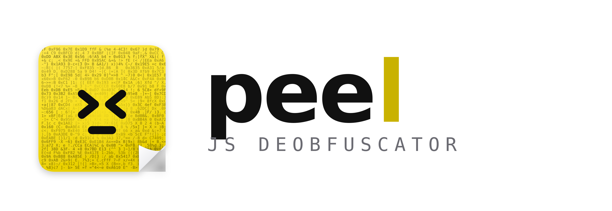
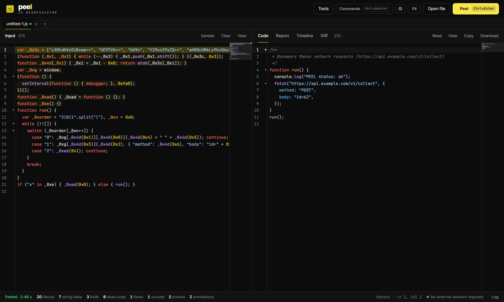
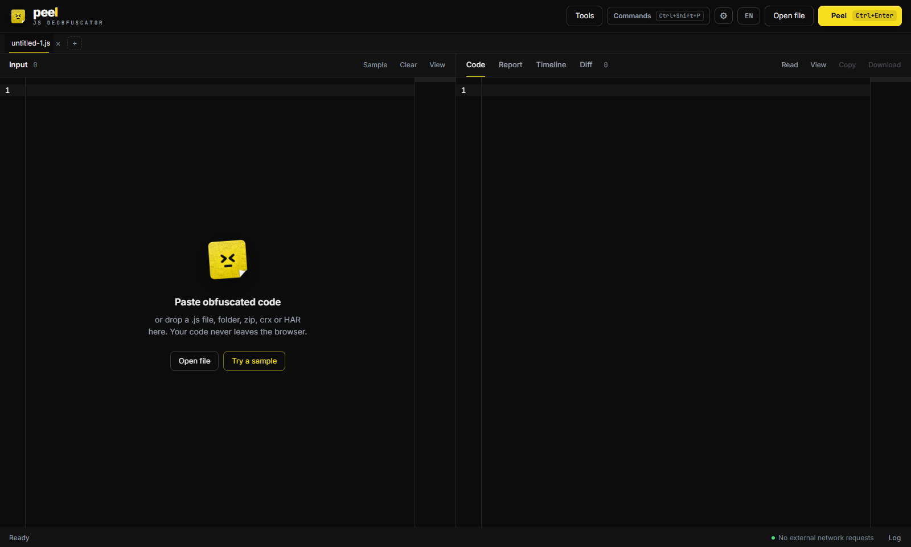
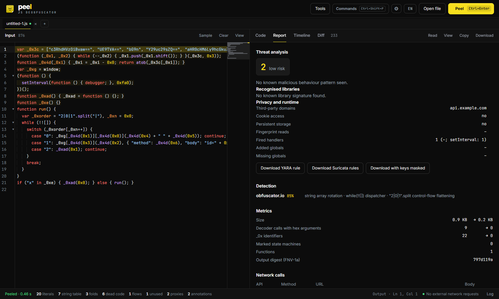
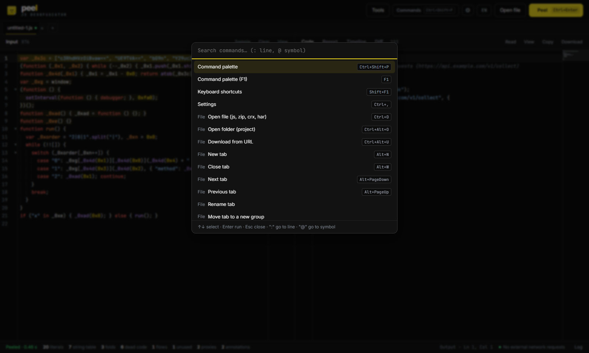
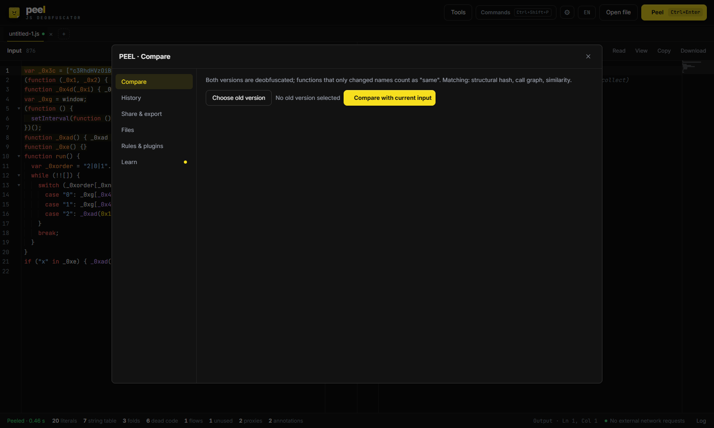
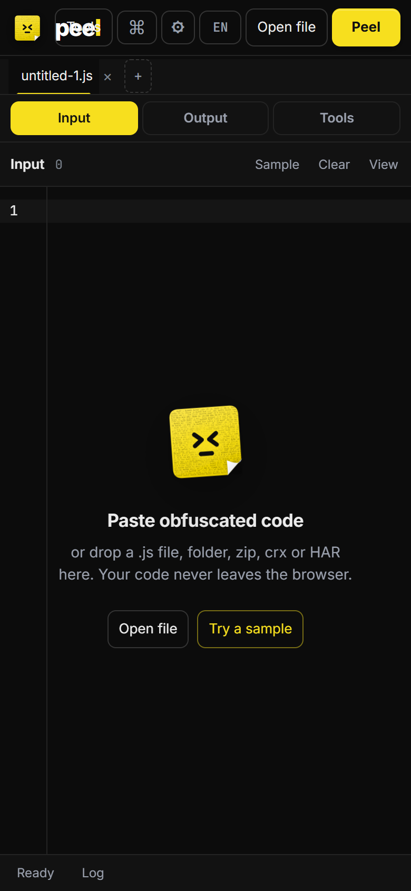
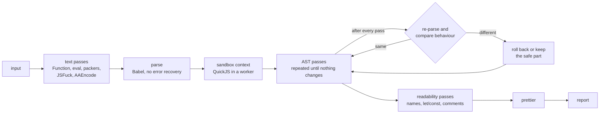

<p align="center">
  <picture>
    <source media="(prefers-color-scheme: dark)" srcset="public/peel-logo-horizontal-dark-3000.png">
    
  </picture>
</p>

<p align="center">
  <b>Peel the obfuscation off JavaScript, right in your browser.</b><br>
  Open source · MIT · free forever · your code never leaves your device
</p>

<p align="center">
  <a href="README.tr.md">Türkçe</a> ·
  <a href="#quick-start">Quick start</a> ·
  <a href="#examples">Examples</a> ·
  <a href="#features">Features</a> ·
  <a href="#command-line">CLI</a> ·
  <a href="#how-it-works">How it works</a> ·
  <a href="ROADMAP.md">Roadmap</a>
</p>

<p align="center">
  
</p>

---

## What is PEEL?

PEEL is a JavaScript deobfuscator. Paste obfuscated code, press **Peel** (`Ctrl + Enter`), and you get readable code back,
plus a report of what the code actually does.

Most deobfuscators either pattern-match, which is fast but gives up on anything custom, or `eval` your input, which is dangerous.
PEEL does both carefully:

- **It runs the code, safely.** Anything that needs execution runs inside a [QuickJS](https://github.com/justjake/quickjs-emscripten)
  sandbox compiled to WebAssembly, in a separate worker with a watchdog. Memory and time are limited, there is no network and no real DOM,
  and the clock and randomness are fixed.
- **It proves its own changes.** After every pass the output is parsed again and executed again. If the program's observable
  behaviour changes, that pass is rolled back automatically, or only the safe parts of it are kept.
- **It reaches decoders that other tools miss.** Decoders hidden in closures, counter-based calls (`M(T + 273)`), self-modifying string
  tables and js-confuser dispatchers are captured at runtime and resolved with the real function.
- **It tells you what the code does.** The report shows the obfuscator it detected, the network calls the code tried to make,
  browser fingerprinting, storage access, IOCs, a threat score, and YARA / Suricata rules you can download.
- **It stays on your machine.** There is no server, no telemetry and no upload. The status bar counts every external request the page makes,
  so you can check this yourself.

One button runs everything at the maximum level. There are no settings you have to understand first.

## Quick start

You need Node.js 20 or newer.

```bash
git clone https://github.com/LLCForge/Peel-JS.git
cd Peel-JS
npm install
npm run dev
```

Open <http://localhost:5173>. Paste code, drop a `.js` file onto the page, or click **Try a sample**, then press **Peel**.

To build a static site you can host anywhere (GitHub Pages, Netlify, an internal server, a USB stick):

```bash
npm run build
```

The `dist/` folder is the whole app. It also works offline as a PWA after the first visit.

## Screenshots

<table>
  <tr>
    <td width="50%"><br><sub><b>Start screen.</b> Paste, drop a file or a folder, or try the sample.</sub></td>
    <td width="50%"><br><sub><b>Input.</b> A CodeMirror editor with highlighting, folding and a minimap.</sub></td>
  </tr>
  <tr>
    <td><br><sub><b>Report.</b> Threat score, privacy, detected tool, metrics, network calls and IOCs.</sub></td>
    <td><br><sub><b>Timeline.</b> Scrub through the code after every pass and round.</sub></td>
  </tr>
  <tr>
    <td><br><sub><b>Diff.</b> What changed between the input and the output.</sub></td>
    <td><br><sub><b>Command palette.</b> Every action, searchable (<code>Ctrl + Shift + P</code>).</sub></td>
  </tr>
  <tr>
    <td><br><sub><b>Tools.</b> Compare versions, history, sharing, archives, rules and plugins, lessons.</sub></td>
    <td><br><sub><b>Settings.</b> Sandbox limits, formatting, naming, passes and appearance.</sub></td>
  </tr>
</table>

<p align="center">
  <br>
  <sub>The interface also works on a phone.</sub>
</p>

## Examples

All outputs below were produced by the CLI (`peel input.js --lang en`) with default settings.
The browser gives the same result, because it uses the same engine.

### javascript-obfuscator (obfuscator.io)

Settings: string array with RC4 encoding, control-flow flattening, dead-code injection, self-defending.
The original 204-byte function became 6.8 KB:

```js
function _0x4dd7(){const _0xefa4e7=['ysFdUJy','A8kWWR5Peq','nL10Fmk2WPFcQ8kH','W6hcISozjx8qWOldSG',
'gmonsqfZ','WP4NWPtcS8oIW5ncW7tdSmk/W6e','WPJdKCkBW65uW6/dS8of','vHJdGwddM8kzWPxcO8oPzJ8', … 6.8 KB
```

PEEL output:

```js
/**
 * @summary Makes network requests (https://api.example.com/track)
 * @param {{ name: string; id: number }} options
 * @returns {Promise<Response>}
 */
function greet(options) {
  const str8 = "Hello, " + options.name + "!";
  console.log(str8);
  return fetch("https://api.example.com/track", {
    method: "POST",
    body: options.id,
  });
}
greet({
  name: "Ada",
  id: 42,
});
```

The RC4 string table, the rotation, the control-flow switch, the dead branches and the self-defending trap are gone.
Types and the parameter name come from how the function is used.

### js-confuser (`medium` preset)

The same 204 bytes became 60 KB: a `Function()` wrapper, a hashed integrity check, a compressed string table,
spoofed `length` values, a dispatcher and flattened control flow.

```js
Function("oS2V2y","var f6VKVp,lHOwPsI,vAwCmmh,pnpNZQh,I0LNn2,Y_2bfv,D5yj4L,xIg8rM,JvQ7zCW,_GiUkD,MR6fIDt;
function FICqkyY(f6VKVp){var lHOwPsI=(f6VKVp|0x0)^0x9e3779b9,vAwCmmh=0x243f6a88|0x0, … 60 KB
```

PEEL output:

```js
(function (oS2V2y) {
  /**
   * @summary Makes network requests (https://api.example.com/track)
   * @param {{ name: string; id: number }} a
   * @returns {Promise<Response>}
   */
  function fn_2vnpRN(a) {
    let OHMPgZ_2 = "Hello, " + a.name + "!";
    console.log(OHMPgZ_2);
    return fetch("https://api.example.com/track", {
      method: "POST",
      body: a.id,
    });
  }
  return fn_2vnpRN({
    name: "Ada",
    id: 42,
  });
})({
  get EBLwagC() {
    return global;
  },
});
```

### Small ones

| Input | Output |
|---|---|
| `eval(atob("Y29uc29sZS5sb2coImhpIik="))` | `console.log("hi");` |
| `(function(){var _0x1=["\x6c\x6f\x67","\x48\x65\x6c\x6c\x6f","\x77\x6f\x72\x6c\x64"];console[_0x1[0x0]](_0x1[0x1]+" "+_0x1[0x2]);})();` | `(function () { console.log("Hello world"); })();` |
| `var o={KJs:function(a,b){return a+b},xQz:function(f,x){return f(x)}};console.log(o.KJs(0x2,0x3),o.xQz(String,0x7));` | `console.log(5, "7");` |
| `if(!![]){console.log("live")}else{console.log("dead")}` | `console.log("live");` |

## Features

PEEL has **57 passes** and a set of analysis modules. The [roadmap](ROADMAP.md) lists all 763 completed items, each with notes.
This is the short version.

### Supported obfuscators

| Tool / technique | What PEEL undoes |
|---|---|
| **javascript-obfuscator / obfuscator.io** | String arrays (none / base64 / RC4), rotation, wrappers, index offsets, object-key and operator proxies, control-flow flattening, dead-code injection, self-defending, debug protection, console disabling, `numbersToExpressions`, `splitStrings`, `transformObjectKeys`. The settings used to obfuscate are reported back. |
| **js-confuser** | `Function()` packing, RGF, dispatcher, flatten, control-flow flattening (including scope objects and labels), global concealing, string compression and concealing, `length` spoofing, opaque predicates, integrity and self-defending locks, anti-tooling, duplicate-literal tables |
| **webpack-obfuscator, webpack and esbuild bundles** | Module split into files (`--split`), dev-mode `eval` bundles, the obfuscator plugin |
| **jfogs, JavaScriptObfuscate, packer** | All variants in the benchmark, including unicode and reverse modes |
| **JSFuck, AAEncode, JJEncode** | Decoded through `eval` and `Function` hooks in the sandbox |
| **Bytecode VMs and state machines** | Detected, disassembled, lifted to readable code where the interpreter can be identified; transitions are annotated otherwise |
| **Babel and TypeScript output** | Helpers, `regenerator` state machines, classes and destructuring turned back into modern syntax |
| **Encodings** | base64 / 32 / 85 / 91, hex, URL, HTML entities, UTF-7, CESU-8, ROT-n, Atbash, XOR (key search), Vigenère, 5–7 bit packing, gzip and deflate inside base64, multi-layer chains |

### Engine

- **Verified passes.** Every pass runs on a fresh parse. The output is checked by parsing it again and by comparing behaviour
  (console output and observable side effects) in the sandbox. A failing pass is rolled back; when only part of it is wrong,
  the changes that keep behaviour are kept.
- **Fixpoint rounds.** Passes repeat until nothing changes. Readability passes (renaming, `let`/`const`, modern syntax,
  comments) run only after decoding has settled, so they never hide a pattern from a decoder.
- **Runtime observation.** Decoders whose arguments come from counters or closures are resolved by observing a real run,
  and the log says which values came from observation.
- **Symbolic and concolic analysis.** A built-in CDCL / bit-blasting solver with DRUP proof checking proves opaque predicates.
  [Z3](https://github.com/Z3Prover/z3) is used as an optional accelerator.
- **Compiler-style clean-up.** SSA, constant propagation, loop and CFG simplification, partial evaluation and dead-store removal,
  all checked by the verifier.
- **Naming.** Deterministic, meaningful names derived from usage (`options`, `str`, `list`, `fn_…`), type inference,
  JSDoc summaries in English or Turkish, recovery of names from source maps and from libraries it recognises.

### Analysis report

- Detected obfuscator with confidence and evidence, plus the settings it was most likely run with
- Threat score and classes: skimmer, stealer, miner, redirector, fingerprinting and more
- Network calls the code attempted (fetch, XHR, WebSocket, beacon, image, script), with method, URL and body
- Privacy: third-party domains, cookie and storage access, fingerprint reads, added and missing globals
- IOCs: domains, URLs, IPs, emails, wallets, JWTs and embedded secrets (masked on export)
- Crypto constants and algorithms (AES, DES, TEA, Blowfish, RC4, hashes), compression, encodings
- YARA and Suricata rules, SARIF, an incident-response report and JSON export
- Metrics before and after, readability score, complexity, pass timings and rolled-back changes

### Interface

- CodeMirror editors with highlighting, folding, minimap, search, go-to-definition and references
- Multiple tabs, sessions saved on the device (IndexedDB), JSON session import and export
- Timeline, diff, call graph, CFG and data-flow views
- Step-by-step mode (approve each pass), dry run, and running only on a selection
- Command palette, configurable shortcuts and layouts, reading mode, mobile layout
- Five languages: English, Türkçe, Deutsch, Español, العربية (right-to-left)
- Accessible: keyboard navigation, screen-reader labels and live regions, visible focus

## Command line

The CLI uses the same engine and the same sandbox. In Node the sandbox runs in a `worker_thread` with a watchdog.

```bash
node bin/peel.js obfuscated.js -o clean.js --report report.json
cat obfuscated.js | node bin/peel.js - > clean.js
node bin/peel.js src/ --out-dir out --sarif out/peel.sarif
node bin/peel.js app.js --html before-after.html --lang en
```

Install it globally with `npm link` and use `peel` instead of `node bin/peel.js`.

| Option | |
|---|---|
| `-o, --out` / `-d, --out-dir` | output file, or output folder for batch mode (keeps the folder structure) |
| `-r, --report`, `--sarif`, `--html`, `--incident` | JSON report, SARIF 2.1.0, standalone before/after HTML, incident-response Markdown |
| `-m, --source-map`, `--out-map` | recover names from a source map; write a map from the output back to the input |
| `-s, --split <dir>` | write the modules of a webpack, esbuild, browserify or Parcel bundle as separate files |
| `-p, --profile`, `-l, --level` | pass profile (`all`, `auto` or a tool name) and level 1–4 |
| `--order-search`, `--cascade` | try several pass orders and keep the best verified result; or peel level by level |
| `--vm-out <dir>`, `--jsvmp` | dump bytecode, assembly, IR and lifted code for bytecode VMs |
| `--git <dir>` | create a git repository with one commit per pass |
| `--style auto`, `-f, --format` | follow `.prettierrc` / `.editorconfig` / `.eslintrc`, or use a format profile |
| `--rules`, `--plugin`, `--trust` | transformation rules, plugins, and Ed25519 keys to trust for signed plugins |
| `--fail-on <level>` | exit with code 4 if the risk reaches `low`, `medium` or `high` (for CI) |
| `--lang <tr\|en>` | language of the code comments and the HTML report |
| `-w, --watch`, `-q, --quiet`, `--json` | watch for changes, silence logs, print results as JSON |

Subcommands (`peel <command> --help`):

| Command | |
|---|---|
| `peel diff old.js new.js` | semantic diff that ignores renames and matches functions across versions; `--port-names` carries your names over |
| `peel track <file\|url>` | watch a script, deobfuscate each new version and report what changed |
| `peel serve` | local REST API on `127.0.0.1` with a bearer token |
| `peel bot` | Slack / Discord slash-command bot with signature checks |
| `peel asar app.asar -o dir` | unpack an Electron archive and deobfuscate its scripts |
| `peel symbols a.js b.js` | cross-file symbol map; `--rename old=new` renames everywhere |
| `peel share` / `peel unshare` | a link that carries the code in the URL fragment, optionally AES-GCM encrypted |
| `peel plugin keygen\|sign\|verify` | sign and verify pass plugins |
| `peel asm`, `peel vm-compare` | VM disassembly and comparison of two VM builds |
| `peel explain`, `techniques`, `learn`, `ctf`, `obfuscate --test`, `anonymize`, `history`, `changelog`, `passes` | learning tools, test-case anonymiser, local history |

Exit codes: `0` ok, `1` error, `2` usage, `3` changed (`track --once`), `4` risk threshold reached.

## Library

```bash
npm install github:LLCForge/Peel-JS
```

```js
import { peel, deobfuscate, analyze, semanticDiff } from 'peel-js';

const { code, report, verified } = await peel(obfuscatedSource);
console.log(code);                 // readable code
console.log(verified);             // true if every change was behaviour-checked
console.log(report.fingerprint);   // [{ name: 'obfuscator.io', confidence: 0.85, … }]
console.log(report.iocs.urls);     // ['https://api.example.com/track']
```

TypeScript types are included. Node-only helpers (file-based history, style-file lookup, Semgrep) are in `peel-js/node`.
`npm run build:lib` builds a single-file ESM bundle.

## Integrations

Everything runs locally. Nothing uploads your code, and the servers bind to `127.0.0.1` only.

| | |
|---|---|
| **GitHub Action** | `uses: LLCForge/Peel-JS@main` with `files: dist/**/*.js`; writes SARIF for code scanning and a step summary |
| **VS Code** | [`extensions/vscode`](extensions/vscode): deobfuscate the current file or selection, report in a side panel |
| **mitmproxy, Burp Suite** | [`extensions/mitmproxy`](extensions/mitmproxy), [`extensions/burp`](extensions/burp): deobfuscate scripts as they pass through the proxy |
| **Jupyter, Observable** | [`extensions/jupyter`](extensions/jupyter), [`extensions/observable`](extensions/observable) |
| **Semgrep** | [`extensions/semgrep`](extensions/semgrep): rules for the deobfuscated output |
| **Desktop** | [`src-tauri`](src-tauri): a Tauri app (`cargo install tauri-cli --version ^2 && cargo tauri build`) |

## How it works



Every pass is a small module in [`src/passes/`](src/passes) with the signature `export async function run(ast, ctx)`.
The order, levels and dependencies are in [`src/core/registry.js`](src/core/registry.js).

| Folder | Contents |
|---|---|
| `src/passes/` | the 57 passes |
| `src/core/` | pipeline, parsing, detection, encodings, crypto, threat analysis, VM lifting |
| `src/sandbox/` | QuickJS host, browser stubs, watchdog, worker and `worker_thread` hosts |
| `src/analysis/`, `src/opt/`, `src/symbolic/` | CFG, data flow, SSA, solver, symbolic and concolic execution |
| `src/naming/` | renaming, type inference, summaries, library recognition |
| `src/ui/` | the web interface |
| `src/cli/`, `src/server/` | CLI, REST API and bots |
| `test/` | fixtures, unit tests and the benchmark |

## Safety model

- Untrusted code runs only inside QuickJS (WebAssembly) in a worker. The worker has a memory cap and an interrupt deadline,
  and a watchdog restarts it if it hangs, for example on catastrophic regex backtracking. **Stop** terminates it immediately.
- The sandbox has no network and no real DOM. Browser APIs are stubs that record what the code tried to do.
  Time and `Math.random` are fixed so that every run is repeatable.
- The test suite includes 18 sandbox-escape attempts (prototype pollution of the host, `Function` and constructor chains,
  timers, workers, imports and more). All of them must fail.
- Plugins can be required to carry an Ed25519 signature from a key you trust.
- The optional real-DOM mode runs the code in a sandboxed iframe with `Content-Security-Policy: default-src 'none'`,
  so it cannot load anything. The status bar counts every external request the page makes.

## Honest limits

- The behaviour check compares console output and observable side effects. Code that prints nothing and touches nothing
  gets a weaker check, and the report says so.
- Values resolved by **observing one run** cover the paths that run took. Paths it did not take are not covered.
- Logic inside WebAssembly, and strings encrypted with a key fetched from a server at runtime, are out of reach.
- Very large inputs (several MB) work, but the page can be busy for a while, because the passes run on the main thread.
- Z3 is optional. Its WebAssembly file is about 39 MB and needs a cross-origin-isolated page (COOP / COEP headers).
  Where that is not available, the built-in solver is used instead.
- The Slack / Discord bots and the Burp extension have not been tested in real workspaces yet. The VS Code extension is not on the Marketplace.

## Tests

```bash
npm test          # 158 fixtures through the whole pipeline with behaviour checks, then 39 unit test files
npm test packer   # a single fixture, with its log and output
npm run bench     # 131 samples from 8 obfuscators: output must behave the same and contain the expected strings
```

A fixture is a `.js` file in [`test/fixtures/`](test/fixtures) with directive comments:

```js
// LEVEL: 3                      optional, default 4
// EXPECT: console.log("hi");    must appear in the output
// GONE: atob                    must not appear in the output
```

## Contributing

Issues and pull requests are welcome. If you have a sample PEEL does not handle, please open an issue with a small,
anonymised version of it. `peel anonymize sample.js` removes strings and names that could identify the source.
A pull request that adds a fixture proving the fix is the fastest way to get it merged.

How the obfuscators in the benchmark work, and how PEEL undoes each technique, is described in
[`docs/research/obfuscators.md`](docs/research/obfuscators.md).

## License

[MIT](LICENSE). Free to use, change and redistribute, including commercially. There is no paid tier, no account and no telemetry.
