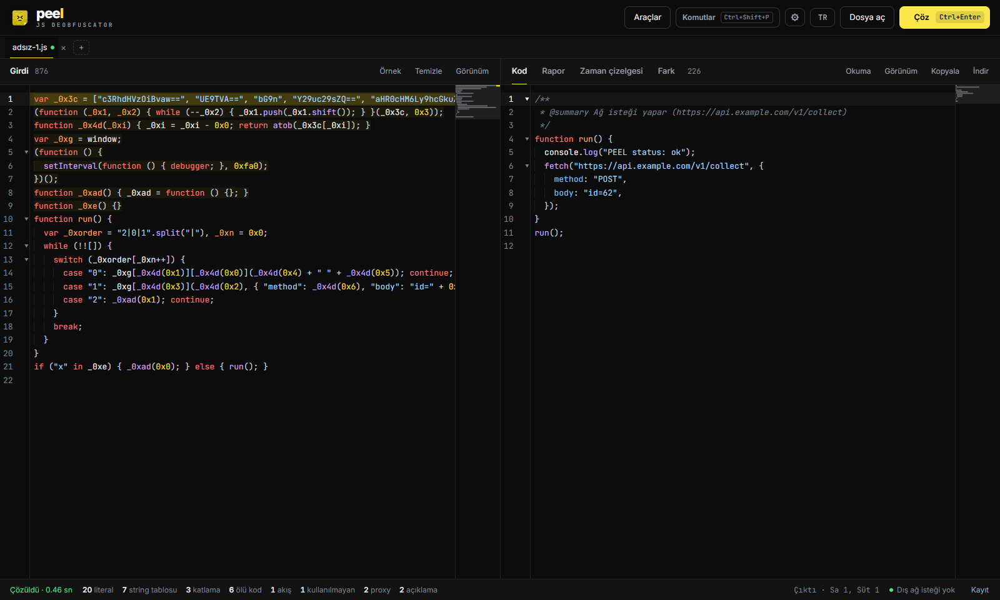
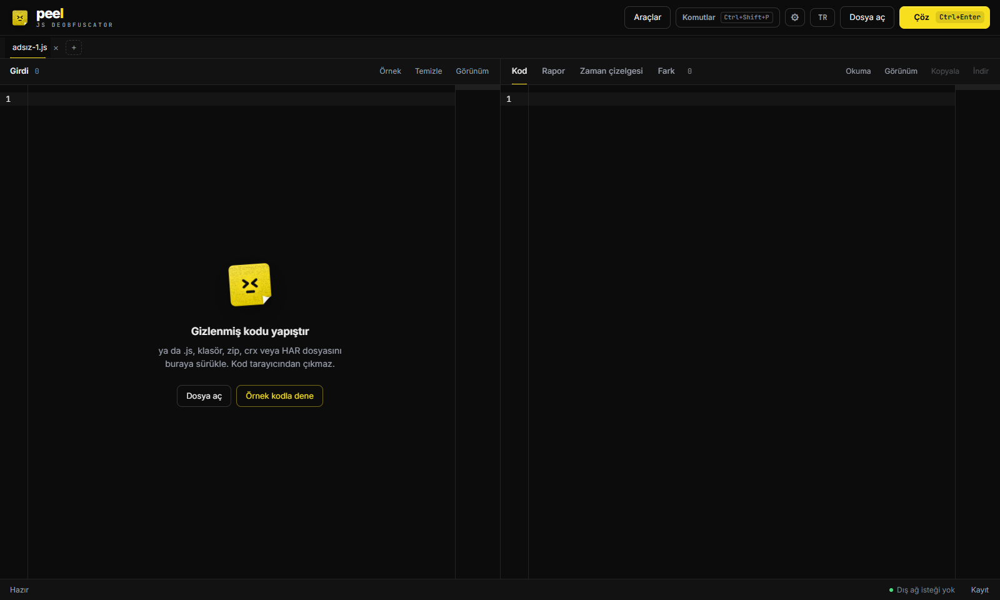
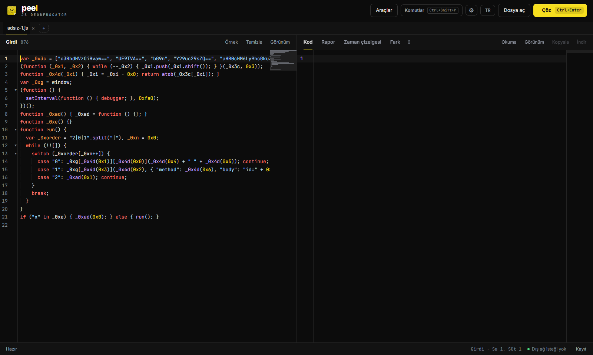
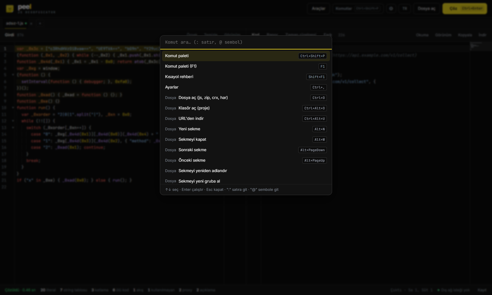
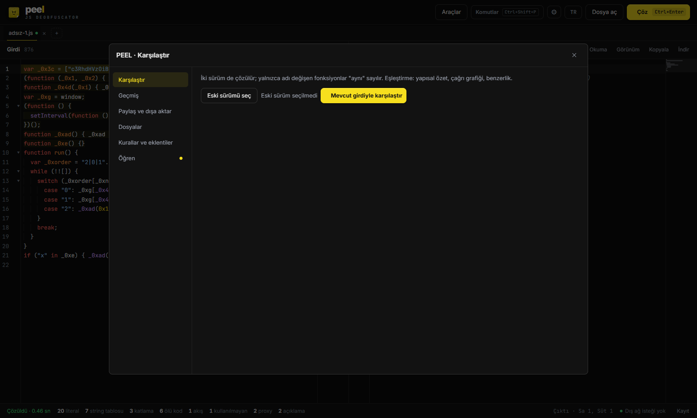
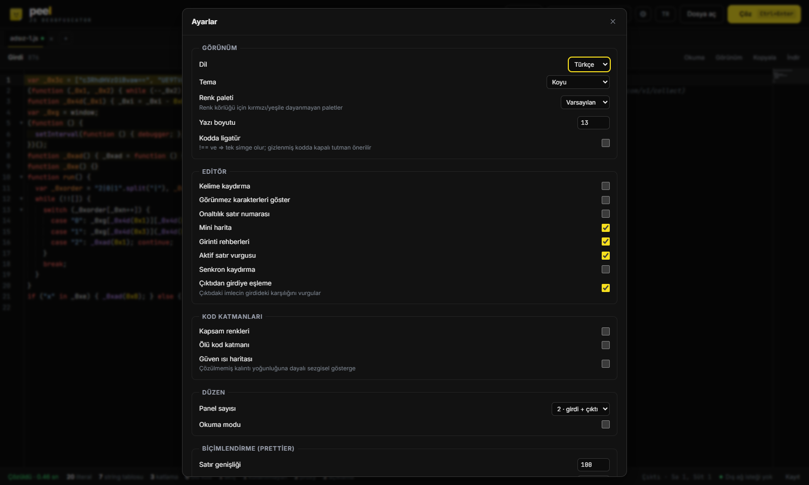
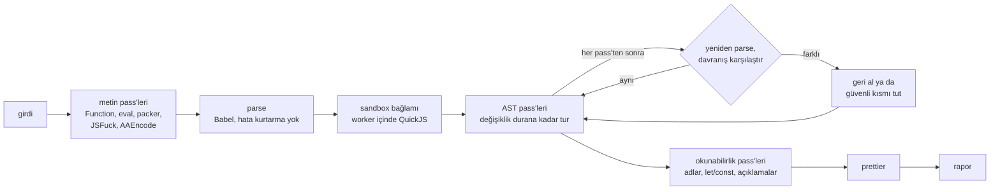

<p align="center">
  <picture>
    <source media="(prefers-color-scheme: dark)" srcset="public/peel-logo-horizontal-dark-3000.png">
    
  </picture>
</p>

<p align="center">
  <b>JavaScript'teki gizlemeyi tarayıcının içinde soyar.</b><br>
  Açık kaynak · MIT · sonsuza dek ücretsiz · kodunuz cihazınızdan çıkmaz
</p>

<p align="center">
  <a href="README.md">English</a> ·
  <a href="#hızlı-başlangıç">Hızlı başlangıç</a> ·
  <a href="#örnekler">Örnekler</a> ·
  <a href="#özellikler">Özellikler</a> ·
  <a href="#komut-satırı">CLI</a> ·
  <a href="#nasıl-çalışır">Nasıl çalışır</a> ·
  <a href="ROADMAP.md">Yol haritası</a>
</p>

<p align="center">
  
</p>

---

## PEEL nedir?

PEEL bir JavaScript deobfuscator'ıdır. Gizlenmiş (obfuscate edilmiş) kodu yapıştırın, **Çöz**'e basın (`Ctrl + Enter`).
Okunur kodu ve kodun gerçekte ne yaptığını anlatan bir raporu geri alırsınız.

Çoğu deobfuscator ya kalıp eşler ya da girdinizi `eval` eder. Kalıp eşlemek hızlıdır ama özel bir şeyle karşılaşınca vazgeçer;
`eval` ise tehlikelidir. PEEL ikisini de dikkatle yapar:

- **Kodu çalıştırır, güvenle.** Çalıştırma gereken her adım, WebAssembly'ye derlenmiş bir [QuickJS](https://github.com/justjake/quickjs-emscripten)
  sandbox'ında, bekçili ayrı bir worker içinde yapılır. Bellek ve süre sınırlıdır; ağ ve gerçek DOM yoktur; saat ve rastgelelik sabittir.
- **Kendi değişikliklerini kanıtlar.** Her pass'ten sonra çıktı yeniden parse edilir ve yeniden çalıştırılır. Programın gözlenen davranışı
  değişirse o pass otomatik geri alınır ya da yalnızca güvenli kısmı tutulur.
- **Başka araçların ulaşamadığı decoder'lara ulaşır.** Closure içine saklanmış decoder'lar, sayaçlı çağrılar (`M(T + 273)`),
  kendini değiştiren string tabloları ve js-confuser dispatcher'ları çalışma anında yakalanır ve gerçek fonksiyonla çözülür.
- **Kodun ne yaptığını söyler.** Raporda tespit edilen obfuscator, kodun yapmaya çalıştığı ağ çağrıları, tarayıcı parmak izi okumaları,
  depolama erişimi, IOC'ler, tehdit puanı ve indirilebilir YARA / Suricata kuralları bulunur.
- **Makinenizde kalır.** Sunucu, telemetri ya da yükleme yoktur. Durum çubuğu sayfanın yaptığı her dış isteği sayar;
  bunu kendiniz kontrol edebilirsiniz.

Tek düğme her şeyi en yüksek seviyede çalıştırır. Önce anlamanız gereken bir ayar yoktur.

## Hızlı başlangıç

Node.js 20 ya da daha yenisi gerekir.

```bash
git clone https://github.com/LLCForge/Peel-JS.git
cd Peel-JS
npm install
npm run dev
```

<http://localhost:5173> adresini açın. Kodu yapıştırın, bir `.js` dosyasını sayfaya sürükleyin ya da **Örnek kodla dene**'ye tıklayın,
sonra **Çöz**'e basın.

Her yerde barındırabileceğiniz statik bir site için (GitHub Pages, Netlify, şirket içi sunucu, USB bellek):

```bash
npm run build
```

`dist/` klasörü uygulamanın tamamıdır. İlk ziyaretten sonra PWA olarak çevrimdışı da çalışır.

## Ekran görüntüleri

<table>
  <tr>
    <td width="50%"><br><sub><b>Başlangıç.</b> Yapıştırın, dosya ya da klasör sürükleyin veya örneği deneyin.</sub></td>
    <td width="50%"><br><sub><b>Girdi.</b> Renklendirme, katlama ve mini haritalı CodeMirror editörü.</sub></td>
  </tr>
  <tr>
    <td><br><sub><b>Rapor.</b> Tehdit puanı, gizlilik, tespit edilen araç, ölçümler, ağ çağrıları ve IOC'ler.</sub></td>
    <td><br><sub><b>Zaman çizelgesi.</b> Her pass ve turdan sonraki kodu kaydırarak izleyin.</sub></td>
  </tr>
  <tr>
    <td><br><sub><b>Fark.</b> Girdi ile çıktı arasında neyin değiştiği.</sub></td>
    <td><br><sub><b>Komut paleti.</b> Tüm eylemler, aranabilir (<code>Ctrl + Shift + P</code>).</sub></td>
  </tr>
  <tr>
    <td><br><sub><b>Araçlar.</b> Sürüm karşılaştırma, geçmiş, paylaşım, arşivler, kurallar ve eklentiler, dersler.</sub></td>
    <td><br><sub><b>Ayarlar.</b> Sandbox sınırları, biçim, isimlendirme, pass'ler ve görünüm.</sub></td>
  </tr>
</table>

<p align="center">
  <br>
  <sub>Arayüz telefonda da çalışır.</sub>
</p>

## Örnekler

Aşağıdaki çıktıların hepsi varsayılan ayarlarla CLI'dan (`peel girdi.js`) alındı.
Tarayıcı aynı motoru kullandığı için aynı sonucu verir.

### javascript-obfuscator (obfuscator.io)

Ayarlar: RC4 kodlamalı string dizisi, akış düzleştirme, ölü kod enjeksiyonu, self-defending.
204 baytlık özgün fonksiyon 6,8 KB oldu:

```js
function _0x4dd7(){const _0xefa4e7=['ysFdUJy','A8kWWR5Peq','nL10Fmk2WPFcQ8kH','W6hcISozjx8qWOldSG',
'gmonsqfZ','WP4NWPtcS8oIW5ncW7tdSmk/W6e','WPJdKCkBW65uW6/dS8of','vHJdGwddM8kzWPxcO8oPzJ8', … 6,8 KB
```

PEEL çıktısı:

```js
/**
 * @summary Ağ isteği yapar (https://api.example.com/track)
 * @param {{ name: string; id: number }} options
 * @returns {Promise<Response>}
 */
function greet(options) {
  const str8 = "Hello, " + options.name + "!";
  console.log(str8);
  return fetch("https://api.example.com/track", {
    method: "POST",
    body: options.id,
  });
}
greet({
  name: "Ada",
  id: 42,
});
```

RC4 string tablosu, rotasyon, akış switch'i, ölü dallar ve self-defending tuzağı kalktı.
Tipler ve parametre adı, fonksiyonun nasıl kullanıldığından çıkarıldı.

### js-confuser (`medium` hazır ayarı)

Aynı 204 bayt 60 KB oldu: `Function()` sarmalayıcısı, hash'li bütünlük denetimi, sıkıştırılmış string tablosu,
sahte `length` değerleri, dispatcher ve düzleştirilmiş akış.

```js
Function("oS2V2y","var f6VKVp,lHOwPsI,vAwCmmh,pnpNZQh,I0LNn2,Y_2bfv,D5yj4L,xIg8rM,JvQ7zCW,_GiUkD,MR6fIDt;
function FICqkyY(f6VKVp){var lHOwPsI=(f6VKVp|0x0)^0x9e3779b9,vAwCmmh=0x243f6a88|0x0, … 60 KB
```

PEEL çıktısı:

```js
(function (oS2V2y) {
  /**
   * @summary Ağ isteği yapar (https://api.example.com/track)
   * @param {{ name: string; id: number }} a
   * @returns {Promise<Response>}
   */
  function fn_2vnpRN(a) {
    let OHMPgZ_2 = "Hello, " + a.name + "!";
    console.log(OHMPgZ_2);
    return fetch("https://api.example.com/track", {
      method: "POST",
      body: a.id,
    });
  }
  return fn_2vnpRN({
    name: "Ada",
    id: 42,
  });
})({
  get EBLwagC() {
    return global;
  },
});
```

### Küçük örnekler

| Girdi | Çıktı |
|---|---|
| `eval(atob("Y29uc29sZS5sb2coImhpIik="))` | `console.log("hi");` |
| `(function(){var _0x1=["\x6c\x6f\x67","\x48\x65\x6c\x6c\x6f","\x77\x6f\x72\x6c\x64"];console[_0x1[0x0]](_0x1[0x1]+" "+_0x1[0x2]);})();` | `(function () { console.log("Hello world"); })();` |
| `var o={KJs:function(a,b){return a+b},xQz:function(f,x){return f(x)}};console.log(o.KJs(0x2,0x3),o.xQz(String,0x7));` | `console.log(5, "7");` |
| `if(!![]){console.log("live")}else{console.log("dead")}` | `console.log("live");` |

## Özellikler

PEEL'de **57 pass** ve bir dizi analiz modülü var. [Yol haritası](ROADMAP.md), tamamlanan 763 maddenin hepsini notlarıyla listeler.
Burada kısa hâli var.

### Desteklenen obfuscator'lar

| Araç / teknik | PEEL'in geri aldıkları |
|---|---|
| **javascript-obfuscator / obfuscator.io** | String dizileri (yok / base64 / RC4), rotasyon, sarmalayıcılar, indeks ofsetleri, nesne anahtarı ve operatör proxy'leri, akış düzleştirme, ölü kod enjeksiyonu, self-defending, debug koruması, konsol kapatma, `numbersToExpressions`, `splitStrings`, `transformObjectKeys`. Gizlemede kullanılan ayarlar raporda geri çıkarılır. |
| **js-confuser** | `Function()` paketleme, RGF, dispatcher, flatten, akış düzleştirme (kapsam nesneleri ve etiketler dahil), global gizleme, string sıkıştırma ve gizleme, `length` sahteciliği, opak koşullar, bütünlük ve self-defending kilitleri, anti-tooling, tekrar eden literal tabloları |
| **webpack-obfuscator, webpack ve esbuild paketleri** | Modülleri dosyalara ayırma (`--split`), geliştirme modundaki `eval` paketleri, obfuscator eklentisi |
| **jfogs, JavaScriptObfuscate, packer** | Benchmark'taki tüm varyantlar (unicode ve ters modlar dahil) |
| **JSFuck, AAEncode, JJEncode** | Sandbox'taki `eval` ve `Function` kancalarıyla çözülür |
| **Bytecode VM'leri ve durum makineleri** | Tespit edilir, disassemble edilir, yorumlayıcı tanınabiliyorsa okunur koda çevrilir; değilse geçişler açıklama olarak yazılır |
| **Babel ve TypeScript çıktısı** | Yardımcılar, `regenerator` durum makineleri, sınıflar ve destructuring modern sözdizimine döndürülür |
| **Kodlamalar** | base64 / 32 / 85 / 91, hex, URL, HTML varlıkları, UTF-7, CESU-8, ROT-n, Atbash, XOR (anahtar aramalı), Vigenère, 5–7 bit paketleme, base64 içinde gzip ve deflate, çok katmanlı zincirler |

### Motor

- **Doğrulanmış pass'ler.** Her pass taze bir parse üzerinde çalışır. Çıktı yeniden parse edilerek ve sandbox'ta davranışı
  (konsol çıktısı ve gözlenebilir yan etkiler) karşılaştırılarak denetlenir. Başarısız pass geri alınır; yalnızca bir kısmı
  hatalıysa davranışı koruyan değişiklikler tutulur.
- **Sabit noktaya kadar turlar.** Pass'ler hiçbir şey değişmeyene kadar tekrarlanır. Okunabilirlik pass'leri (isimlendirme,
  `let`/`const`, modern sözdizimi, açıklamalar) çözme bittikten sonra çalışır; böylece bir decoder'ın tanıyacağı kalıbı gizlemezler.
- **Çalışma anı gözlemi.** Argümanları sayaçtan ya da closure'dan gelen decoder'lar gerçek bir çalıştırma gözlenerek çözülür;
  log hangi değerin gözlemden geldiğini söyler.
- **Sembolik ve concolic analiz.** DRUP kanıt denetimli yerleşik bir CDCL / bit-blasting çözücü opak koşulları kanıtlar.
  [Z3](https://github.com/Z3Prover/z3) isteğe bağlı hızlandırıcı olarak kullanılır.
- **Derleyici tarzı temizlik.** SSA, sabit yayılımı, döngü ve CFG sadeleştirme, kısmi değerlendirme ve ölü atama temizliği;
  hepsi doğrulayıcıdan geçer.
- **İsimlendirme.** Kullanımdan çıkarılan, deterministik ve anlamlı adlar (`options`, `str`, `list`, `fn_…`), tip çıkarımı,
  Türkçe ya da İngilizce JSDoc özetleri, kaynak haritasından ve tanınan kütüphanelerden ad kurtarma.

### Analiz raporu

- Güven oranı ve kanıtıyla tespit edilen obfuscator ve büyük olasılıkla kullanılan ayarlar
- Tehdit puanı ve sınıfları: skimmer, stealer, miner, yönlendirici, parmak izi ve diğerleri
- Kodun denediği ağ çağrıları (fetch, XHR, WebSocket, beacon, image, script); yöntem, URL ve gövdeyle
- Gizlilik: üçüncü taraf alan adları, çerez ve depolama erişimi, parmak izi okumaları, eklenen ve eksik global'ler
- IOC'ler: alan adları, URL'ler, IP'ler, e-postalar, cüzdanlar, JWT'ler ve gömülü gizli anahtarlar (dışa aktarımda maskelenir)
- Kripto sabitleri ve algoritmaları (AES, DES, TEA, Blowfish, RC4, hash'ler), sıkıştırma, kodlamalar
- YARA ve Suricata kuralları, SARIF, olay müdahale raporu ve JSON dışa aktarma
- Önce/sonra ölçümleri, okunabilirlik puanı, karmaşıklık, pass süreleri ve geri alınan değişiklikler

### Arayüz

- Renklendirme, katlama, mini harita, arama, tanıma git ve referansları olan CodeMirror editörleri
- Birden çok sekme, cihazda kaydedilen oturumlar (IndexedDB), JSON oturum içe/dışa aktarma
- Zaman çizelgesi, fark, çağrı grafiği, CFG ve veri akışı görünümleri
- Adım adım mod (her pass'i onaylama), kuru çalıştırma ve yalnızca seçimi çözme
- Komut paleti, ayarlanabilir kısayollar ve yerleşimler, okuma modu, mobil yerleşim
- Beş dil: Türkçe, English, Deutsch, Español, العربية (sağdan sola)
- Erişilebilir: klavye ile gezinme, ekran okuyucu etiketleri ve canlı bölgeler, görünür odak

## Komut satırı

CLI aynı motoru ve aynı sandbox'ı kullanır. Node'da sandbox bekçili bir `worker_thread` içinde çalışır.

```bash
node bin/peel.js gizli.js -o temiz.js --report rapor.json
cat gizli.js | node bin/peel.js - > temiz.js
node bin/peel.js src/ --out-dir cikti --sarif cikti/peel.sarif
node bin/peel.js app.js --html once-sonra.html
```

`npm link` ile global kurup `node bin/peel.js` yerine `peel` yazabilirsiniz.

| Seçenek | |
|---|---|
| `-o, --out` / `-d, --out-dir` | çıktı dosyası ya da toplu işte çıktı klasörü (klasör yapısı korunur) |
| `-r, --report`, `--sarif`, `--html`, `--incident` | JSON rapor, SARIF 2.1.0, bağımsız önce/sonra HTML, olay müdahale Markdown'ı |
| `-m, --source-map`, `--out-map` | kaynak haritasından ad kurtarma; çıktıdan girdiye harita yazma |
| `-s, --split <dizin>` | webpack, esbuild, browserify ya da Parcel paketinin modüllerini ayrı dosyalara yazma |
| `-p, --profile`, `-l, --level` | pass profili (`all`, `auto` ya da araç adı) ve 1–4 seviye |
| `--order-search`, `--cascade` | birkaç pass sırası deneyip en iyi doğrulanmış sonucu tutma; ya da seviye seviye çözme |
| `--vm-out <dizin>`, `--jsvmp` | bytecode VM'ler için bytecode, assembly, IR ve çevrilmiş kodu yazma |
| `--git <dizin>` | her pass bir commit olacak şekilde git deposu oluşturma |
| `--style auto`, `-f, --format` | `.prettierrc` / `.editorconfig` / `.eslintrc` kurallarına uyma ya da biçim profili |
| `--rules`, `--plugin`, `--trust` | dönüşüm kuralları, eklentiler ve imzalı eklentiler için güvenilen Ed25519 anahtarları |
| `--fail-on <düzey>` | risk `low`, `medium` ya da `high` düzeyine ulaşırsa 4 koduyla çıkma (CI için) |
| `--lang <tr\|en>` | kod içi açıklamaların ve HTML raporun dili |
| `-w, --watch`, `-q, --quiet`, `--json` | değişiklikleri izleme, logları susturma, sonuçları JSON olarak yazma |

Alt komutlar (`peel <komut> --help`):

| Komut | |
|---|---|
| `peel diff eski.js yeni.js` | yeniden adlandırmaları yok sayan, fonksiyonları sürümler arasında eşleyen anlamsal fark; `--port-names` adlarınızı taşır |
| `peel track <dosya\|url>` | bir script'i izler, her yeni sürümü çözer ve neyin değiştiğini raporlar |
| `peel serve` | `127.0.0.1` üzerinde bearer token'lı yerel REST API |
| `peel bot` | imza denetimli Slack / Discord slash komut botu |
| `peel asar app.asar -o dizin` | Electron arşivini açar ve script'lerini çözer |
| `peel symbols a.js b.js` | dosyalar arası sembol haritası; `--rename eski=yeni` her yerde yeniden adlandırır |
| `peel share` / `peel unshare` | kodu URL parçasında taşıyan, isteğe bağlı AES-GCM şifreli bağlantı |
| `peel plugin keygen\|sign\|verify` | pass eklentilerini imzalama ve doğrulama |
| `peel asm`, `peel vm-compare` | VM disassembly'si ve iki VM derlemesinin karşılaştırılması |
| `peel explain`, `techniques`, `learn`, `ctf`, `obfuscate --test`, `anonymize`, `history`, `changelog`, `passes` | öğrenme araçları, test örneği anonimleştirici, yerel geçmiş |

Çıkış kodları: `0` tamam, `1` hata, `2` kullanım, `3` değişiklik (`track --once`), `4` risk eşiğine ulaşıldı.

## Kütüphane

```bash
npm install github:LLCForge/Peel-JS
```

```js
import { peel, deobfuscate, analyze, semanticDiff } from 'peel-js';

const { code, report, verified } = await peel(gizliKaynak);
console.log(code);                 // okunur kod
console.log(verified);             // her değişiklik davranış denetiminden geçtiyse true
console.log(report.fingerprint);   // [{ name: 'obfuscator.io', confidence: 0.85, … }]
console.log(report.iocs.urls);     // ['https://api.example.com/track']
```

TypeScript tipleri pakete dahildir. Node'a özgü yardımcılar (dosya tabanlı geçmiş, stil dosyası arama, Semgrep) `peel-js/node` altındadır.
`npm run build:lib` tek dosyalık bir ESM paketi üretir.

## Entegrasyonlar

Hepsi yerelde çalışır. Hiçbiri kodunuzu yüklemez; sunucular yalnızca `127.0.0.1`'e bağlanır.

| | |
|---|---|
| **GitHub Action** | `uses: LLCForge/Peel-JS@main` ve `files: dist/**/*.js`; code scanning için SARIF ve adım özeti yazar |
| **VS Code** | [`extensions/vscode`](extensions/vscode): açık dosyayı ya da seçimi çözer, raporu yan panelde gösterir |
| **mitmproxy, Burp Suite** | [`extensions/mitmproxy`](extensions/mitmproxy), [`extensions/burp`](extensions/burp): proxy'den geçen script'leri çözer |
| **Jupyter, Observable** | [`extensions/jupyter`](extensions/jupyter), [`extensions/observable`](extensions/observable) |
| **Semgrep** | [`extensions/semgrep`](extensions/semgrep): çözülmüş çıktı için kurallar |
| **Masaüstü** | [`src-tauri`](src-tauri): Tauri uygulaması (`cargo install tauri-cli --version ^2 && cargo tauri build`) |

## Nasıl çalışır



Her pass, [`src/passes/`](src/passes) içinde `export async function run(ast, ctx)` imzalı küçük bir modüldür.
Sıra, seviyeler ve bağımlılıklar [`src/core/registry.js`](src/core/registry.js) içindedir.

| Klasör | İçerik |
|---|---|
| `src/passes/` | 57 pass |
| `src/core/` | pipeline, parse, tespit, kodlamalar, kripto, tehdit analizi, VM çevirisi |
| `src/sandbox/` | QuickJS host'u, tarayıcı taklitleri, bekçi, worker ve `worker_thread` host'ları |
| `src/analysis/`, `src/opt/`, `src/symbolic/` | CFG, veri akışı, SSA, çözücü, sembolik ve concolic yürütme |
| `src/naming/` | yeniden adlandırma, tip çıkarımı, özetler, kütüphane tanıma |
| `src/ui/` | web arayüzü |
| `src/cli/`, `src/server/` | CLI, REST API ve botlar |
| `test/` | fixture'lar, birim testleri ve benchmark |

## Güvenlik modeli

- Güvenilmeyen kod yalnızca bir worker içindeki QuickJS'te (WebAssembly) çalışır. Worker'ın bellek sınırı ve kesme süresi vardır;
  kilitlenirse (ör. felaket düzeyde regex geri izlemesi) bekçi onu yeniden başlatır. **Durdur** onu anında sonlandırır.
- Sandbox'ta ağ ve gerçek DOM yoktur. Tarayıcı API'leri, kodun ne yapmaya çalıştığını kaydeden taklitlerdir.
  Her çalıştırma tekrarlanabilsin diye zaman ve `Math.random` sabittir.
- Test paketinde 18 sandbox kaçış denemesi var (host prototip kirletme, `Function` ve constructor zincirleri, zamanlayıcılar,
  worker'lar, import'lar ve diğerleri). Hepsinin başarısız olması gerekir.
- Eklentilerin, güvendiğiniz bir anahtarla Ed25519 imzası taşıması zorunlu tutulabilir.
- İsteğe bağlı gerçek DOM modu kodu `Content-Security-Policy: default-src 'none'` olan sandbox'lı bir iframe'de çalıştırır;
  kod hiçbir şey yükleyemez. Durum çubuğu sayfanın yaptığı her dış isteği sayar.

## Dürüst sınırlar

- Davranış denetimi konsol çıktısını ve gözlenebilir yan etkileri karşılaştırır. Hiçbir şey yazdırmayan ve hiçbir şeye dokunmayan kod
  daha zayıf bir denetimden geçer; rapor bunu belirtir.
- **Tek bir çalıştırma gözlenerek** çözülen değerler, o çalıştırmanın geçtiği yolları kapsar. Geçmediği yollar kapsanmaz.
- WebAssembly içindeki mantık ve çalışma anında sunucudan alınan bir anahtarla şifrelenmiş string'ler kapsam dışıdır.
- Çok büyük girdiler (birkaç MB) çalışır, ama pass'ler ana thread'de çalıştığı için sayfa bir süre meşgul kalabilir.
- Z3 isteğe bağlıdır. WebAssembly dosyası yaklaşık 39 MB'tır ve cross-origin isolated bir sayfa (COOP / COEP başlıkları) gerektirir.
  Bu yoksa yerleşik çözücü kullanılır.
- Slack / Discord botları ve Burp eklentisi henüz gerçek çalışma alanlarında denenmedi. VS Code eklentisi Marketplace'te değil.

## Testler

```bash
npm test          # 158 fixture tüm pipeline'dan davranış denetimiyle geçer, ardından 39 birim test dosyası
npm test packer   # tek bir fixture, log ve çıktısıyla
npm run bench     # 8 obfuscator'dan 131 örnek: çıktı aynı davranmalı ve beklenen string'leri içermeli
```

Fixture, [`test/fixtures/`](test/fixtures) içinde yönerge yorumları olan bir `.js` dosyasıdır:

```js
// LEVEL: 3                      isteğe bağlı, varsayılan 4
// EXPECT: console.log("hi");    çıktıda bulunmalı
// GONE: atob                    çıktıda bulunmamalı
```

## Katkı

Issue ve pull request'ler memnuniyetle karşılanır. PEEL'in çözemediği bir örneğiniz varsa küçük ve anonimleştirilmiş bir sürümüyle
issue açın. `peel anonymize ornek.js`, kaynağı ele verebilecek string'leri ve adları temizler.
Düzeltmeyi kanıtlayan bir fixture ekleyen pull request en hızlı birleşen pull request'tir.

Benchmark'taki obfuscator'ların nasıl çalıştığı ve PEEL'in her tekniği nasıl geri aldığı
[`docs/research/obfuscators.md`](docs/research/obfuscators.md) belgesinde anlatılıyor.

## Lisans

[MIT](LICENSE). Ticari kullanım dahil özgürce kullanabilir, değiştirebilir ve dağıtabilirsiniz. Ücretli sürüm, hesap ya da telemetri yoktur.
